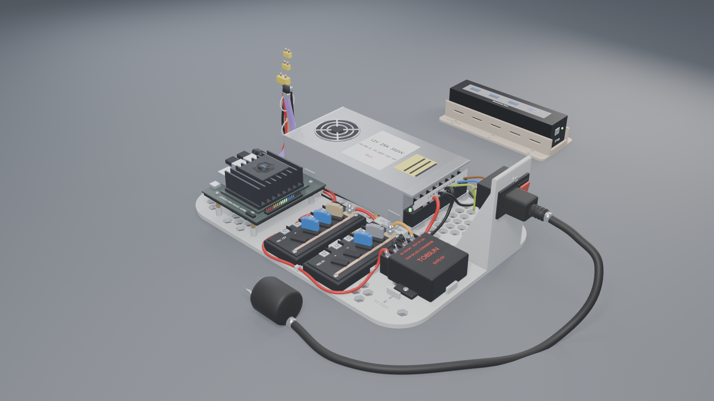
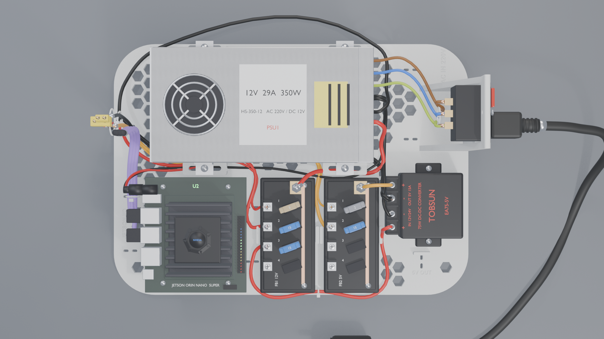
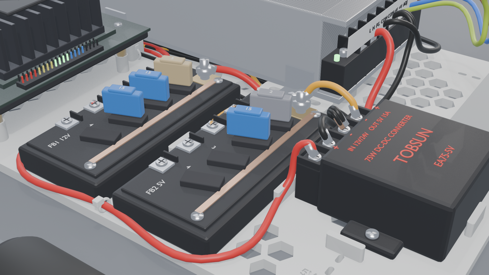

# Kiro Wiring

[English](README.md) | **한국어**

**Kiro / SO-101 모바일 듀얼암 로봇**의 전원 시스템과 전장 패키징 프로젝트입니다. 이 로봇은 NVIDIA Jetson Orin Nano를 중심으로 SO-101 로봇 암과 메카넘 휠 베이스로 구성된 모바일 매니퓰레이터입니다.

로봇 카트의 여러 벽 어댑터와 엉킨 케이블을 **SMPS 1개, 퓨즈로 보호되는 12 V / 5 V 분배, 벅 컨버터 1개**로 정리하고, 이를 카트 하단 바구니의 3D 프린팅 베이스 플레이트에 장착합니다.

  

---

## 저장소 구성

| 폴더 | 내용 |
|---|---|
| [`images/`](images) | 전원 플레이트 렌더 이미지와 **배선도** – 여기서 시작하세요 |
| [`docs/`](docs) | 전원 시스템 설계, 부품 목록 |
| [`3d_models/`](3d_models) | STEP 파일 (Fusion 360), OBJ, 상세 Blender 씬, `print_files/` (Bambu Lab P1S용 3MF) |

---

## 시스템 개요

  

| 항목 | 부품 |
|---|---|
| 전원 공급 장치 | HS-350-12 SMPS, 12 V 약 29 A, 팬 냉각 |
| 5 V 전원 | TOBSUN EA75-5V 벅 컨버터, 5 V 15 A |
| 분배 | Dorhea 4구 블레이드 퓨즈 박스 2개 – FB1 12 V, FB2 5 V |
| 컴퓨터 | NVIDIA Jetson Orin Nano Super, 12 V 전원 |
| 구동부 | 휠 서보 ST3215 4개 (12 V), 리더 암 + 팔로워 암 (5 V) |
| AC 입력 | 스위치와 5 A 지연형 퓨즈가 내장된 IEC C14 인렛 |

| 퓨즈 | 박스 | 전원 | 부하 | 전선 |
|---|---|---|---|---|
| F1 5 A | FB1 | 12 V | Jetson | 18 AWG |
| F2 15 A | FB1 | 12 V | 휠 서보 | 14 AWG |
| F3 15 A | FB1 | 12 V | 벅 컨버터 입력 | 14 AWG |
| F4 2 A | FB2 | 5 V | 리더 암 | 20 AWG |
| F5 15 A | FB2 | 5 V | 팔로워 암 | 14 AWG |

접지 버스바는 사용하지 않습니다. 12 V 리턴선은 SMPS COM 단자로, 5 V 리턴선은 벅 컨버터의 OUT− 단자로 연결합니다.
전체 계산, 전선 규격, 초기 가동 절차: **[docs/power_system_design.md](docs/power_system_design.md)** (영문).

---

## 하드웨어

  
  

**베이스 플레이트** (하단 바구니, 330 × 235 mm): SMPS를 팬이 위를 향하도록 슬롯형 받침대 위에 눕혀 고정하고, Jetson은 10 mm 스탠드오프 위에, 퓨즈 박스 2개, 벅 컨버터, AC 인렛(하단이 플레이트에서 67 mm 높이로 바구니 테두리 위)을 장착합니다. 통풍용 허니콤 구멍, 모든 케이블 경로의 케이블 타이 고정부, 각인 라벨을 갖추고 있습니다.

**USB 허브 트레이** (중간 층): ST Lab USB 허브를 포트가 위를 향하도록 고정합니다. 허브가 연결하는 암, 카메라, 라이다와 가깝고 전원 배선과는 떨어져 있습니다.

### 출력 (Bambu Lab P1S)

| 파일 | 크기 | 비고 |
|---|---|---|
| `3d_models/print_files/base_plate_left.3mf` | 118 × 231 × 15 mm | – |
| `3d_models/print_files/base_plate_right.3mf` | 217 × 231 × 112 mm | AC 인렛 타워 포함 |
| `3d_models/print_files/usb_hub_tray.3mf` | 165 × 73 × 25 mm | – |

PETG 또는 ASA, 레이어 0.2 mm, 벽 3개, 인필 15–20 %, 평평한 면을 아래로, 서포트 불필요. 플레이트 두 조각은 도브테일 부분을 접착합니다.

### 3D 모델

| 파일 | 용도 |
|---|---|
| `3d_models/base_plate.step` | 전체 플레이트 – Fusion 360 **File → Open** |
| `3d_models/assembly.step` / `.obj` | 플레이트 + 허브 트레이 |
| `3d_models/KIRO_power_plate.blend` | 모든 부품과 배선이 포함된 상세 씬 (Blender 5.2) |

---

## 문서 (영문)

| 문서 | 내용 |
|---|---|
| [전원 시스템 설계](docs/power_system_design.md) | 구조, 부하 계산, 퓨즈, 배선, 초기 가동 절차, 향후 업그레이드 |
| [부품 목록](docs/parts_list.md) | 보유 부품, 구매 필요 부품, 출력 부품 |

---

## 안전

AC 쪽에는 상용 전원(220 V)이 흐릅니다. 모든 스페이드 단자를 절연하고, 보호 접지(PE)를 SMPS FG 단자에 연결하고, SMPS 입력 스위치를 220 V로 설정하며, 배선 작업 전에는 반드시 로봇의 전원 플러그를 뽑으세요.
