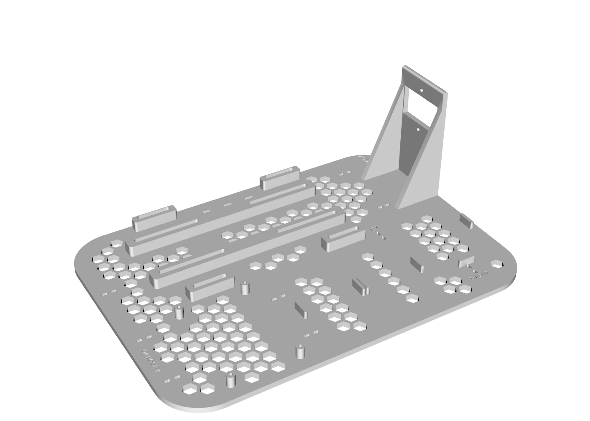
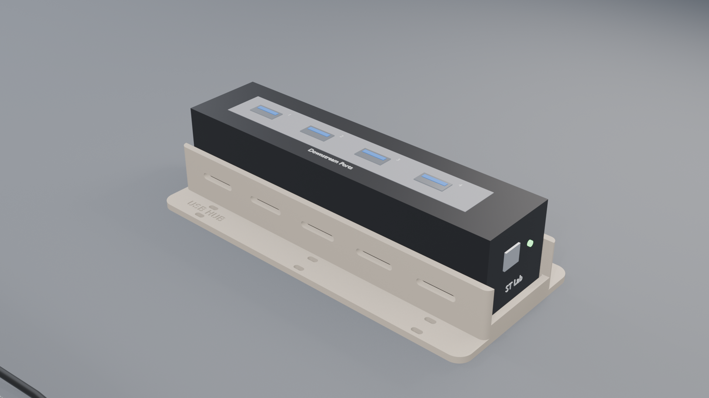
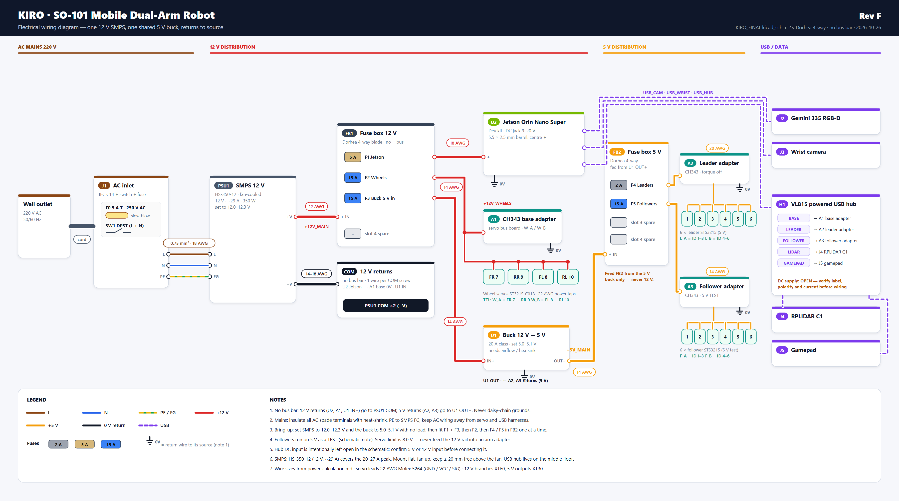

# Kiro Wiring

[English](README.md) | **한국어**

**Kiro / SO-101 모바일 듀얼암 로봇**의 전원 시스템과 전장 패키징 저장소입니다. 이 로봇은 NVIDIA Jetson Orin Nano를 중심으로 SO-101 리더 암 2개, SO-101 팔로워 암 2개, 메카넘 휠 베이스로 구성된 XLeRobot 방식의 모바일 매니퓰레이터입니다.

이 저장소의 목표는 로봇 카트 위의 여러 벽 어댑터와 엉킨 케이블을 **SMPS 1개, 퓨즈로 보호되는 12 V / 5 V 분배, 벅 컨버터 1개**로 정리하고, 이를 3D 프린팅 부품에 장착하여 R&D 시제품이 아닌 소비자용 제품 수준의 완성도로 만드는 것입니다.

<p align="center">
  
</p>

---

## 파일 위치 안내

```
kiro_wiring/
├── blender/                    전원 플레이트의 상세 Blender 씬
│   ├── KIRO_power_plate.blend      현재 씬 (v3 배치, 모든 부품과 배선 포함)
│   ├── renders/                    hero, top, close, side, ac, hub 렌더 이미지
│   ├── update_blend_v3.py          v2 파일에서 씬을 재구성한 스크립트
│   └── archive/                    이전 버전 씬
├── cad/                        파라메트릭 CAD (CadQuery)
│   ├── base_plate/                 하단 바구니용 베이스 플레이트
│   │   ├── step/                       Fusion 360용 STEP (전체, 왼쪽, 오른쪽)
│   │   ├── print_3mf/                  Bambu Lab P1S용 출력 파일 (3MF)
│   │   ├── images/                     미리보기 렌더
│   │   └── power_plate.py              소스 코드 – 모든 치수는 파일 상단에 있음
│   ├── usb_hub_tray/               중간 층용 USB 허브 트레이 (step/, print_3mf/, hub_tray.py)
│   └── assembly/                   두 부품을 합친 STEP + OBJ, 렌더 이미지
├── electrical/
│   ├── schematic/                  KIRO_FINAL.kicad_sch (KiCad 회로도)
│   └── wiring_diagram/             배선도 PNG + SVG, 생성 스크립트, 참고용 컨셉 이미지
└── docs/
    ├── design_and_printing_guideline.md   P1S로 출력 가능한 로봇 부품 설계 규칙
    ├── power_system_design/               RevA 설계 문서 (docx + Markdown 원본)
    └── demo_captures_2026-10-21/          소프트웨어 설치 시연 캡처 (로컬 전용, 저장소에 없음)
```

| 하고 싶은 작업 | 열어야 할 파일 |
|---|---|
| 베이스 플레이트 출력 | `cad/base_plate/print_3mf/plate_left.3mf` + `plate_right.3mf` |
| USB 허브 트레이 출력 | `cad/usb_hub_tray/print_3mf/hub_tray.3mf` |
| Fusion 360에서 편집 | `cad/base_plate/step/plate_full.step` 또는 `cad/assembly/kiro_power_tray.step` |
| 전체 3D 씬 보기 | `blender/KIRO_power_plate.blend` |
| 로봇 배선 작업 | `electrical/wiring_diagram/kiro_wiring_diagram.png` |
| 새 바디 부품 설계 | `docs/design_and_printing_guideline.md` |

---

## 카트 전원 베이스 플레이트

카트 하단 바구니(330 × 235 mm, 깊이 55 mm, 모서리 R40)에 들어가는 플레이트 1장으로, 모든 전원 부품을 고정하고 케이블을 짧고 깔끔하게 정리합니다.

<p align="center">
  
</p>

### 구성 부품

| 부품 | 장착 방식 |
|---|---|
| SMPS HS-350-12 (12 V, 약 29 A, 상단 팬), 193 × 100 × 45 mm | 팬이 위를 향하도록 눕혀서 장착. 마운팅 귀 아래에 긴 M4 슬롯이 있는 10 mm 받침대 4개와 지지 레일 2개, 하부에 공기 흐름 공간 확보 |
| Jetson Orin Nano Super 개발 키트 (100 × 90 mm) | 10 mm 스탠드오프 4개 (M2.5/M3 셀프 태핑용 파일럿 홀), I/O 면은 측벽 방향 |
| Dorhea 4구 블레이드 퓨즈 박스 2개 (FB1 12 V, FB2 5 V) | 위치 고정 탭 + 셀프 태핑 나사 |
| DC-DC 벅 컨버터 12 V → 5 V 15 A | 위치 고정 탭 + 셀프 태핑 나사 |
| 퓨즈·스위치 내장 IEC C14 AC 인렛 | +X 쪽 가장자리의 측면 보강대가 있는 112 mm 벽. 인렛 하단이 플레이트 바닥에서 67 mm 높이에 있어 전원 코드가 바구니 테두리에 걸리지 않음 |

접지 버스바는 사용하지 않습니다. 12 V 리턴선은 SMPS COM 단자로, 5 V 리턴선은 벅 컨버터의 OUT− 단자로 연결합니다.

### 특징

- 공기 흐름과 필라멘트 절약을 위한 허니콤 구멍 (10 mm 육각, 2.6 mm 리브)
- 모든 케이블 경로(AC, 12 V, 5 V, Jetson I/O)를 따라 케이블 타이 고정 슬롯
- 각인 라벨: `AC IN 220V`, `12V`, `5V OUT`, `JETSON I/O`
- Bambu Lab P1S 출력을 위해 도브테일 결합으로 두 조각 분할

### 파일 (`cad/base_plate/`)

| 파일 | 용도 |
|---|---|
| `step/plate_full.step` | 전체 플레이트 – Fusion 360에서 열기 (**File → Open**) |
| `print_3mf/plate_full.3mf` | 한 번에 출력 (256 mm보다 큰 베드 필요) |
| `step/` + `print_3mf/` `plate_left` | 왼쪽 조각, 118 × 231 × 15 mm |
| `step/` + `print_3mf/` `plate_right` | AC 타워 포함 오른쪽 조각, 217 × 231 × 112 mm |

### 출력 (Bambu Lab P1S)

- `plate_left.3mf`와 `plate_right.3mf`를 각각 따로 출력합니다. 평평한 면이 아래로, 서포트는 필요 없습니다.
- SMPS에서 열이 나므로 PETG 또는 ASA/ABS를 권장합니다. 레이어 0.2 mm, 벽 3개, 인필 15–20 %.
- 도브테일은 CA(순간접착제) 또는 에폭시로 접착합니다.

### 모델 다시 생성하기

모델은 완전히 파라메트릭입니다. [`power_plate.py`](cad/base_plate/power_plate.py) 상단의 상수를 수정한 뒤 다음을 실행합니다.

```bash
pip install cadquery trimesh networkx lxml vtk
cd cad/base_plate && python power_plate.py && python render.py
cd ../usb_hub_tray && python hub_tray.py
cd ../assembly && python make_exports.py
```

### 확인이 필요한 항목

스크립트에서 `VERIFY`로 표시된 값은 추정치이므로, 최종 출력 전에 실제 부품을 측정해야 합니다.

- Jetson 캐리어 보드 마운팅 홀 간격 (현재 86 × 58 mm)
- SMPS 마운팅 귀 위치 (`SMPS_EAR_X`, `SMPS_EAR_OUT`) – 30 mm 슬롯이 ±12 mm 오차를 흡수
- 퓨즈 박스 2개와 벅 컨버터의 정확한 크기

> SMPS 팬 위에는 최소 20 mm의 빈 공간을 확보하세요. USB 허브는 의도적으로 이 플레이트에 두지 **않으며**, 중간 층의 전용 트레이에 둡니다.

---

## USB 허브 트레이 (중간 층)

<p align="center">
  
</p>

ST Lab USB 허브(157 × 37 × 40 mm) 1개를 포트가 위로 향하도록 눕혀서 고정합니다. 양쪽 끝이 열려 있어 업스트림 USB와 DC 입력 케이블을 연결할 수 있고, 바닥에는 육각 통풍구가 있으며, 양옆 플랜지의 케이블 타이 슬롯 6쌍으로 바구니 메시에 고정합니다. 크기 165 × 73 × 25 mm – P1S에서 한 번에 출력, 서포트 불필요.

허브를 중간 층에 두면 허브가 연결하는 장치(서보 어댑터, 라이다, 게임패드, 카메라)와 가까워져 USB 케이블이 짧아지고, USB 선이 SMPS, AC 배선, 서보 전원선과 떨어지게 됩니다.

---

## Blender 씬

`blender/KIRO_power_plate.blend` (Blender 5.2)에는 모든 부품이 상세하게 들어 있습니다. 단자대와 팬이 있는 SMPS, Jetson, 퓨즈가 꽂힌 퓨즈 박스 2개, 벅 컨버터, C14 인렛, XT60/XT30 상층 연결 커넥터, C13 전원 코드, 트레이에 들어간 USB 허브, 그리고 압착 단자와 케이블 타이가 있는 커브 형태의 모든 배선이 포함됩니다. 카메라: `CAM_hero`, `CAM_top`, `CAM_close`, `CAM_side`, `CAM_ac`, `CAM_hub`.

보관된 v2 씬에서 다시 만들려면:

```bash
blender -b blender/archive/KIRO_power_plate_v2_original.blend --python blender/update_blend_v3.py -- .
```

---

## 전기 배선

<p align="center">
  
</p>

Rev F – `KIRO_FINAL.kicad_sch`를 기반으로 Dorhea 4구 퓨즈 박스 2개를 사용하고 버스바는 없습니다.

| 퓨즈 | 박스 | 전원 | 부하 | 전선 |
|---|---|---|---|---|
| F0 5 A T | J1 인렛 | 220 V AC | SMPS 입력 | 0.75 mm² (18 AWG) |
| F1 5 A | FB1 | 12 V | Jetson Orin Nano (배럴 5.5 × 2.5 mm) | 18 AWG |
| F2 15 A | FB1 | 12 V | 휠 어댑터 + ST3215-C018 4개 | 14 AWG |
| F3 15 A | FB1 | 12 V | 벅 컨버터 12 V → 5 V 입력 | 14 AWG |
| F4 2 A | FB2 | 5 V | 리더 어댑터 + STS3215 6개 | 20 AWG |
| F5 15 A | FB2 | 5 V | 팔로워 어댑터 + STS3215 6개 (5 V 테스트) | 14 AWG |

- SMPS +V → FB1 연결은 12 AWG를 사용합니다.
- 리턴선은 각자의 전원으로 돌아갑니다. Jetson, 베이스 어댑터, 벅 IN− → **PSU1 COM**, 리더·팔로워 어댑터 → **벅 OUT−**. 나사 단자 하나에 전선 하나, 데이지 체인 금지.
- FB2는 반드시 벅 컨버터의 5 V 출력에서만 전원을 받습니다 – 12 V를 절대 연결하지 마세요.

배선도는 `python electrical/wiring_diagram/make_wiring.py`로 다시 생성할 수 있습니다 (PNG 생성에 Chrome 또는 Edge 필요).

---

## 전원 시스템 설계 (요약)

[`docs/power_system_design/`](docs/power_system_design)의 RevA 설계 문서 기준:

- 12 V SMPS 1개가 모든 벽 어댑터를 대체합니다.
- 휠 서보와 Jetson은 12 V로 직접 동작합니다 (Jetson 잭 입력 범위 9–20 V).
- 벅 컨버터가 암 어댑터용 5 V를 만듭니다 (회로도에 따라 팔로워는 5 V로 테스트 중).
- 전체 부하 계산, 회로도, 케이블 목록, 부품 목록은 `Kiro_SO101_Power_System_Design_RevA.docx`를 참고하세요.

---

## 새 로봇 부품 설계

Kiro의 모든 바디 부품은 Bambu Lab P1S로 출력합니다. 모델링을 시작하기 전에 **[설계 및 출력 가이드라인](docs/design_and_printing_guideline.md)**을 꼭 읽어 주세요. 245 mm 부품 크기 제한, 도브테일 분할, 공차, 출력 방향, 재료, 파일 전달 형식(`.step` + `.3mf`)을 다룹니다. (가이드라인 문서는 영어로 작성되어 있습니다.)

---

## 안전

AC 쪽에는 상용 전원(220 V)이 흐릅니다. 모든 스페이드 단자는 수축 튜브로 절연하고, 보호 접지(PE)를 SMPS 접지 단자에 연결하고, 인렛에는 지연형(슬로우 블로우) 퓨즈를 사용하며, 배선 작업 전에는 반드시 로봇의 전원 플러그를 뽑으세요.
