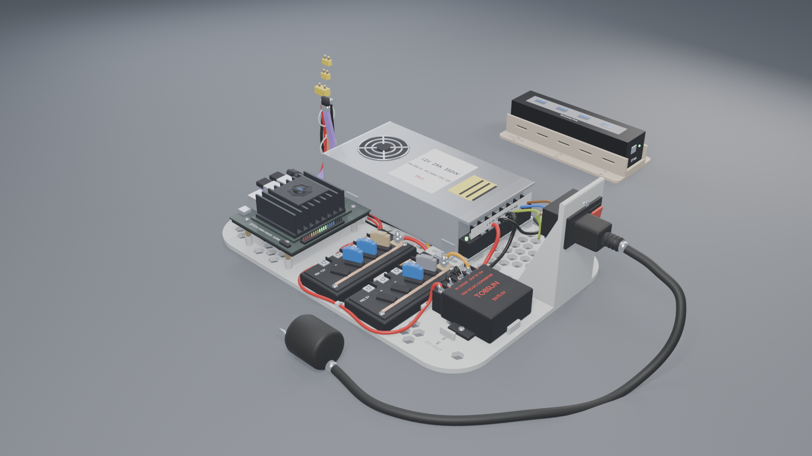

# Kiro Wiring (HAEBOT / KIRO)

[English](README.md) | **한국어**

**HAEBOT**(= **KIRO**, 같은 로봇의 두 이름)의 전원 시스템과 전장 패키징 저장소입니다. Jetson Orin Nano, SO-101 암,
메카넘 베이스로 구성된 모바일 듀얼암 로봇입니다.

<p align="center">
  
</p>

## 버전

| 버전 | 폴더 | 전원 | 상태 |
|---|---|---|---|
| **V1** | [`kiro-wiring/`](kiro-wiring) | AC 전원, 12 V SMPS | 제작 완료. 기준(레거시) 설계 |
| **V2-A** | [`kiro-wiring-2/anker-solix-battery-haebot/`](kiro-wiring-2/anker-solix-battery-haebot) | 앤커 솔릭스 C300 DC 파워 스테이션 | 제안 단계, 실측 검증 전 |
| **V2-B** | [`kiro-wiring-2/ev-battery-haebot/`](kiro-wiring-2/ev-battery-haebot) | 12 V 45 Ah 배터리 | 제안 단계, 배터리·충전기 미확인 |

V2가 두 가지인 이유는 검토 중인 배터리가 두 종류이기 때문입니다. V2-A는 기성품 파워 스테이션에 케이블만 꽂는
간편한 방식이고, V2-B는 V1의 퓨즈 박스 구조를 유지하면서 암을 12 V 서보로 바꾸는 장시간 운용 방식입니다.

## 파일 위치

| 항목 | V1 | V2-A 앤커 | V2-B EV 배터리 |
|---|---|---|---|
| KiCad 회로도 | [`KIRO_FINAL.kicad_sch`](kiro-wiring/kicad/KIRO_FINAL.kicad_sch) | [`HAEBOT_ANKER.kicad_pro`](kiro-wiring-2/anker-solix-battery-haebot/kicad/HAEBOT_ANKER.kicad_pro) | [`HAEBOT_EV.kicad_pro`](kiro-wiring-2/ev-battery-haebot/kicad/HAEBOT_EV.kicad_pro) |
| 회로도 PDF | [Rev F](kiro-wiring/exports/haebot_wiring_FINAL_revF_2026_11_02.pdf) | [Rev A](kiro-wiring-2/anker-solix-battery-haebot/exports/HAEBOT_ANKER_SCHEMATIC.pdf) | [Rev A](kiro-wiring-2/ev-battery-haebot/exports/HAEBOT_EV_SCHEMATIC.pdf) |
| 블록 다이어그램 PDF | - | [PDF](kiro-wiring-2/anker-solix-battery-haebot/exports/HAEBOT_ANKER_BLOCK_DIAGRAM.pdf) | [PDF](kiro-wiring-2/ev-battery-haebot/exports/HAEBOT_EV_BLOCK_DIAGRAM.pdf) |
| BOM | [부품 목록](kiro-wiring/docs/parts_list.md) | [`bom/`](kiro-wiring-2/anker-solix-battery-haebot/bom) | [`bom/`](kiro-wiring-2/ev-battery-haebot/bom) |
| 설계 문서 | [`docs/`](kiro-wiring/docs) | [`docs/`](kiro-wiring-2/anker-solix-battery-haebot/docs) | [`docs/`](kiro-wiring-2/ev-battery-haebot/docs) |

- V2 비교 검토 문서: [`HAEBOT_V2_POWER_SYSTEM_COMPARISON.pdf`](kiro-wiring-2/exports/HAEBOT_V2_POWER_SYSTEM_COMPARISON.pdf)
- 공통 하드웨어 근거 자료: [`docs/hardware_evidence.md`](docs/hardware_evidence.md)
- 공통 이미지: [`images/`](images), 공통 3D 모델·출력 파일: [`3d_models/`](3d_models)

## 검증 상태

| | V1 | V2-A 앤커 | V2-B EV 배터리 |
|---|---|---|---|
| 실제 제작·동작 | 예 | 아니오 | 아니오 |
| 전원 사양 | SMPS 보유 | 앤커 매뉴얼로 확인 | **보류**: 배터리 미확인 |
| 부하 | 실측 | V1 값 사용 | V1 값 사용, 12 V 암 서보는 제안 |
| 회로도 연결 | - | KiCad 넷리스트로 확인 | KiCad 넷리스트로 확인 |
| KiCad ERC | - | 아직 실행 안 함 | 아직 실행 안 함 |
| 미해결 항목 | - | 허브 전원, PD 부품, 벤치 테스트 | 배터리, 충전기, 메인 퓨즈, 레귤레이터, 암 서보 |

각 V2 폴더의 `docs/verification_report.md`에 확인(Verified), 계산(Calculated), 제안(Proposed), 보류(Blocked) 항목이
구분되어 있습니다.

## 편집과 내보내기

1. KiCad를 설치합니다. V2 프로젝트는 KiCad 7 이상, V1과 보관된 V2 초안은 KiCad 10이 필요합니다.
2. 해당 설계의 `.kicad_pro` 파일을 엽니다(V1은 `.kicad_sch` 파일을 직접 엽니다).
3. 수정 후 설계 폴더에서 다시 내보냅니다.

```bash
kicad-cli sch export pdf --no-background-color kicad/HAEBOT_ANKER.kicad_sch -o exports/HAEBOT_ANKER_SCHEMATIC.pdf
rsvg-convert -f pdf -o exports/HAEBOT_ANKER_BLOCK_DIAGRAM.pdf block-diagrams/HAEBOT_ANKER_BLOCK_DIAGRAM.svg
```

블록 다이어그램은 SVG 파일이므로 Inkscape나 텍스트 편집기로 수정할 수 있습니다. 설계 변경 규칙은 각 폴더의
`AGENTS.md`에 있습니다.
