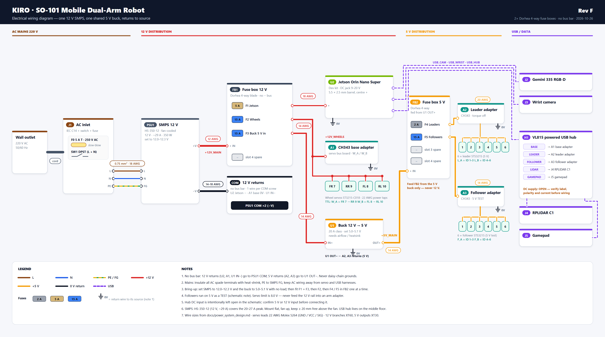

# Kiro Wiring

**English** | [한국어](README.ko.md)

Power system and electronics packaging for the **Kiro / SO-101 mobile dual-arm robot** – a mobile manipulator built around an NVIDIA Jetson Orin Nano with SO-101 arms and a mecanum-wheel base.

The project replaces the robot cart's pile of wall adapters and loose cables with **one SMPS, fused 12 V / 5 V distribution and one buck converter**, all mounted on a 3D-printed base plate in the cart's lower basket.

  

---

## Repository

| Folder | What is inside |
|---|---|
| [`images/`](images) | Renders of the power plate and the **wiring diagram** – start here |
| [`docs/`](docs) | Power system design and parts list |
| [`3d_models/`](3d_models) | STEP files (Fusion 360), OBJ, the detailed Blender scene and `print_files/` (3MF for the Bambu Lab P1S) |

---

## System overview

  

| Item | Part |
|---|---|
| Power supply | HS-350-12 SMPS, 12 V ~29 A, fan-cooled |
| 5 V supply | TOBSUN EA75-5V buck converter, 5 V 15 A |
| Distribution | 2 × Dorhea 4-way blade fuse box – FB1 12 V, FB2 5 V |
| Computer | NVIDIA Jetson Orin Nano Super, powered from 12 V |
| Motion | 4 × ST3215 wheel servos on 12 V, leader + follower arm on 5 V |
| Mains input | IEC C14 inlet with switch and 5 A slow-blow fuse |

| Fuse | Box | Rail | Load | Wire |
|---|---|---|---|---|
| F1 5 A | FB1 | 12 V | Jetson | 18 AWG |
| F2 15 A | FB1 | 12 V | Wheel servos | 14 AWG |
| F3 15 A | FB1 | 12 V | Buck converter input | 14 AWG |
| F4 2 A | FB2 | 5 V | Leader arm | 20 AWG |
| F5 15 A | FB2 | 5 V | Follower arm | 14 AWG |

No ground bus bar: 12 V returns go to the SMPS COM terminals, 5 V returns to the buck's OUT−.
Full calculations, wire sizes and the bring-up checklist: **[docs/power_system_design.md](docs/power_system_design.md)**.

---

## Hardware

  
  

**Base plate** (lower basket, 330 × 235 mm): holds the SMPS flat with its fan up on slotted ear pads, the Jetson on 10 mm standoffs, both fuse boxes, the buck converter and the AC inlet (lower edge 67 mm above the plate, clear of the basket rim). Honeycomb cut-outs for airflow, zip-tie anchors along every cable route, engraved labels.

**USB hub tray** (middle floor): holds the ST Lab USB hub with its ports up, close to the arms, cameras and lidar it serves and away from the power wiring.

### Printing (Bambu Lab P1S)

| File | Size | Notes |
|---|---|---|
| `3d_models/print_files/base_plate_left.3mf` | 118 × 231 × 15 mm | – |
| `3d_models/print_files/base_plate_right.3mf` | 217 × 231 × 112 mm | includes the AC inlet tower |
| `3d_models/print_files/usb_hub_tray.3mf` | 165 × 73 × 25 mm | – |

PETG or ASA, 0.2 mm layers, 3 walls, 15–20 % infill, flat side down, no supports. Glue the two plate halves at the dovetails.

### 3D models

| File | Use |
|---|---|
| `3d_models/base_plate.step` | Complete plate – Fusion 360 **File → Open** |
| `3d_models/assembly.step` / `.obj` | Plate + hub tray |
| `3d_models/KIRO_power_plate.blend` | Detailed scene with every part and wire (Blender 5.2) |

---

## Documents

| Document | Content |
|---|---|
| [Power system design](docs/power_system_design.md) | Architecture, load budget, fuses, wiring, bring-up checklist, planned upgrades |
| [Parts list](docs/parts_list.md) | Bill of materials – on hand, to buy, printed parts |

---

## Safety

The AC side carries mains voltage. Insulate every spade terminal, connect protective earth to the SMPS FG terminal, set the SMPS input switch to 220 V, and always unplug the robot before working on the wiring.
