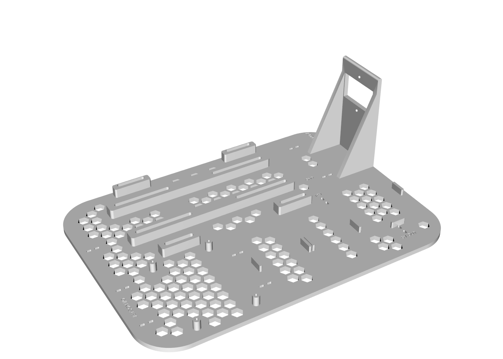
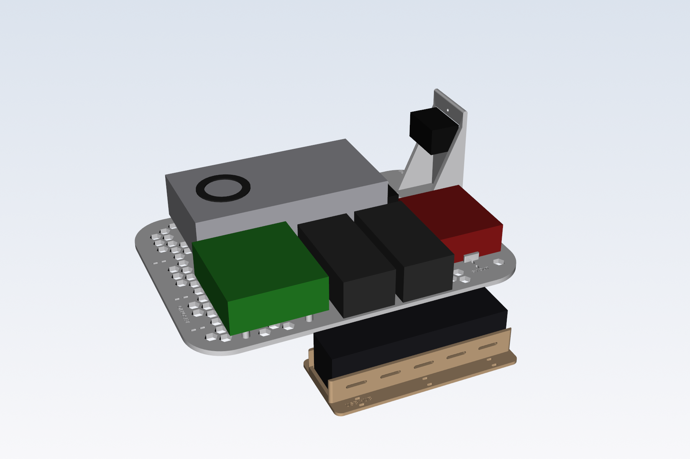
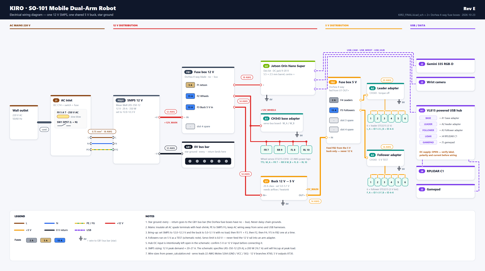

# Kiro Wiring

Power system and electronics packaging for the **Kiro / SO-101 mobile dual-arm robot**: an XLeRobot-style mobile manipulator built around an NVIDIA Jetson Orin Nano, with two SO-101 leader arms, two SO-101 follower arms and a mecanum-wheel base.

The goal of this repository is to replace the pile of wall adapters and loose cables on the robot cart with a **single SMPS, fused 12 V distribution and buck converters**, mounted on 3D-printed hardware so the robot looks and behaves like a consumer-grade product instead of an R&D prototype.

<p align="center">
  
</p>

---

## Repository layout

| Path | Contents |
|---|---|
| [`cart_power_plate/`](cart_power_plate) | Parametric base plate for the cart's lower tray (CadQuery source, STEP + 3MF exports, previews) |
| [`wiring/`](wiring) | Electrical wiring diagram (PNG + SVG) and its generator script |
| [`usb_hub_tray/`](usb_hub_tray) | Printed tray for the USB hub on the cart's middle floor (CadQuery source, STEP + 3MF) |
| [`export/`](export) | Combined STEP and OBJ of the plate + hub tray, and render images |
| [`design_and_printing_guideline.md`](design_and_printing_guideline.md) | Rules for designing robot body parts that print on a Bambu Lab P1S (size limits, dovetail joints, tolerances, materials) |
| [`KIRO_FINAL.kicad_sch`](KIRO_FINAL.kicad_sch) | KiCad schematic of the power system |
| [`group_convo/`](group_convo) | Power system design package: design document (RevA), project context, power calculation, parts list, Markdown sources, and the 2026-10-21 software setup demo captures |

---

## Cart power base plate

A single plate that sits in the cart's lower basket (330 × 235 mm, 55 mm deep, R40 corners) and holds all power electronics with clean, short cable runs.

### Components

| Component | Mounting |
|---|---|
| SMPS HS-350-12 (12 V, ~29 A, fan on top), 193 × 100 × 45 mm | Lies flat, fan up. Four 10 mm riser pads with long M4 slots under its mounting ears, plus two support rails; air gap underneath |
| Jetson Orin Nano Super Dev Kit (100 × 90 mm) | Four 10 mm standoffs (M2.5/M3 self-tap pilot), I/O edge facing the side wall |
| 2 × Dorhea 4-way blade fuse box (FB1 12 V, FB2 5 V) | Locating tabs + self-tapping screws |
| 0 V ground bus bar (GB1) – star point, next to the SMPS −V terminal | Solid pad for self-tapping screws |
| DC-DC buck 12 V → 5 V 15 A | Locating tabs + self-tapping screws |
| IEC C14 AC inlet with fuse and switch | 112 mm wall with side braces at the +X edge; inlet lower edge 67 mm above the plate bottom so the cord clears the basket rim |

### Features

- Honeycomb cut-outs (10 mm hex, 2.6 mm ribs) for airflow and ~20 % less filament
- Zip-tie anchor slots along every cable route (AC, 12 V, fused 12 V, 5 V, Jetson I/O)
- Engraved labels: `AC IN 220V`, `12V`, `FUSED 12V`, `5V OUT`, `JETSON I/O`
- Split into two halves with dovetail joints for printing on a Bambu Lab P1S

### Files

All exports are in [`cart_power_plate/out/`](cart_power_plate/out):

| File | Use |
|---|---|
| `plate_full.step` | Complete plate – open in Fusion 360 (**File → Open**) |
| `plate_full.3mf` | One-piece print (needs a bed larger than 256 mm) |
| `plate_left.step` / `.3mf` | Left half, 118 × 231 × 15 mm |
| `plate_right.step` / `.3mf` | Right half with AC tower, 217 × 231 × 112 mm |

### Printing (Bambu Lab P1S)

- Print `plate_left.3mf` and `plate_right.3mf` as two separate jobs, flat side down, no supports needed.
- PETG or ASA/ABS recommended (the SMPS runs warm); 0.2 mm layers, 3 walls, 15–20 % infill.
- Glue the dovetails with CA or epoxy.

### Regenerating the model

The model is fully parametric. Edit the constants at the top of [`power_plate.py`](cart_power_plate/power_plate.py) (component sizes, positions, hole patterns, honeycomb size), then:

```bash
pip install cadquery trimesh networkx lxml vtk
cd cart_power_plate
python power_plate.py   # writes STEP + 3MF to out/
python render.py        # optional: refreshes the preview images
```

### Open items

Values marked `VERIFY` in the script are estimates from product listings and must be measured on the real parts before final printing:

- Jetson carrier mounting-hole pattern (currently 86 × 58 mm)
- SMPS bottom mounting-hole row spacing (currently 50 mm)
- Exact footprints of the SMPS, the two fuse boxes, the ground bus bar and the buck converter

- SMPS mounting-ear positions (`SMPS_EAR_X`, `SMPS_EAR_OUT`) – the 30 mm slots cover ±12 mm of error

> Keep at least 20 mm of free air above the SMPS fan. The USB hub is deliberately **not** on this plate – it sits on the middle floor in its own tray.

---

## USB hub tray (middle floor)

<p align="center">
  
</p>

Holds one ST Lab USB hub (157 × 37 × 40 mm) flat with its ports facing up. Both ends are open for the upstream USB and DC input cables, the floor has hex vents, and six zip-tie slot pairs in the side flanges tie it to the basket mesh. 165 × 73 × 25 mm – one print on the P1S, no supports.

Keeping the hub on the middle floor puts it next to the devices it feeds (servo adapters, lidar, gamepad, cameras), shortens the USB cables, and keeps USB away from the SMPS, mains wiring and servo power.

## Exports

| File | Use |
|---|---|
| `export/kiro_power_tray.step` | Base plate + hub tray as solids (Fusion 360) |
| `export/kiro_power_tray.obj` | Same parts as meshes (Blender) |
| `export/render_*.png` | Renders (boxes in the assembly render are placeholder components) |
| `usb_hub_tray/out/hub_tray.3mf` | Print-ready hub tray |

---

## Electrical wiring

<p align="center">
  
</p>

Rev E, based on `KIRO_FINAL.kicad_sch` with two Dorhea 4-way fuse boxes:

| Fuse | Box | Rail | Load | Wire |
|---|---|---|---|---|
| F0 5 A T | J1 inlet | 220 V AC | SMPS input | 0.75 mm² (18 AWG) |
| F1 5 A | FB1 | 12 V | Jetson Orin Nano (barrel 5.5 × 2.5 mm) | 18 AWG |
| F2 15 A | FB1 | 12 V | Wheel adapter + 4 × ST3215-C018 | 14 AWG |
| F3 15 A | FB1 | 12 V | Buck 12 V → 5 V input | 14 AWG |
| F4 2 A | FB2 | 5 V | Leader adapter + 6 × STS3215 | 20 AWG |
| F5 15 A | FB2 | 5 V | Follower adapter + 6 × STS3215 (5 V test) | 14 AWG |

- SMPS → FB1 and SMPS → GB1 use 12 AWG.
- The Dorhea boxes have no negative bus, so every 0 V return goes to the **GB1 bus bar** (star ground).
- FB2 is fed only from the buck's 5 V output – never from 12 V.

Regenerate the diagram with `python wiring/make_wiring.py` (needs Chrome or Edge for the PNG).

---

## Power system design (summary)

From the RevA design package in [`group_convo/`](group_convo):

- One 12 V SMPS replaces all wall adapters.
- The wheel servos and the Jetson run directly from 12 V (Jetson jack accepts 9–20 V).
- Buck converters make 7.2 V for the follower arms and 5 V for the USB hub, lidar and leader arms.
- Two blade-fuse groups and a GND bus bar distribute power in a star:
  - **Group A** (Jetson, 5 V buck, spare) is always on.
  - **Group B** (wheels, follower bucks) sits behind a relay driven by a mushroom E-stop and key switch, so a stop kills motion while compute and sensors stay powered.

See `Kiro_SO101_Power_System_Design_RevA.docx` for the full load budget, schematics, cable schedule and parts list.

---

## Designing new robot parts

All Kiro body parts are printed on a Bambu Lab P1S. Before modelling anything, read the **[Design & Printing Guideline](design_and_printing_guideline.md)** – it covers the 245 mm part limit, dovetail splitting, tolerances, print orientation, materials and the file hand-off format (`.step` + `.3mf`).

---

## Safety

The AC side carries mains voltage. Insulate all spade terminals with heat-shrink, connect protective earth to the SMPS earth terminal, use a slow-blow fuse in the inlet, and always unplug the robot before working on the wiring.
