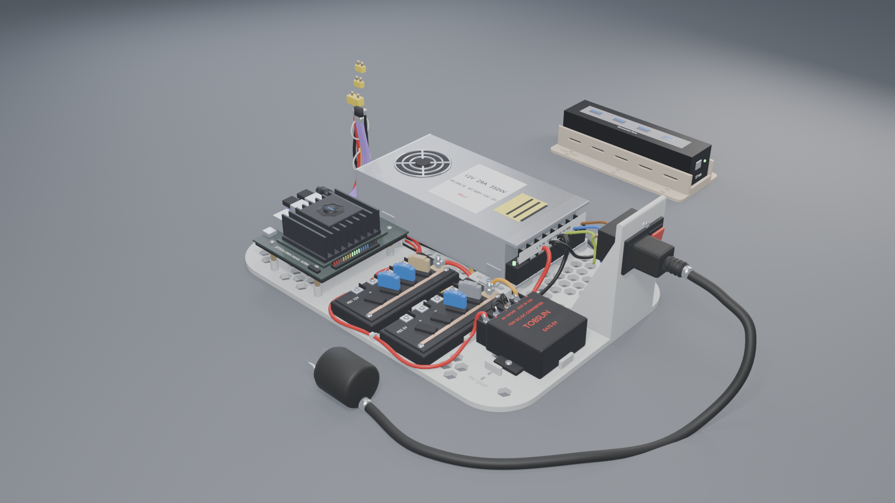

# Kiro Wiring

**English** | [한국어](README.ko.md)

Power system and electronics packaging for the **Kiro / SO-101 mobile dual-arm robot** — Jetson Orin Nano, SO-101 arms, mecanum base.

## Repository layout

| Folder | Contents |
|---|---|
| [`kiro-wiring/`](kiro-wiring) | **V1** AC/SMPS wiring — `KIRO_FINAL.kicad_sch` + PDF |
| [`kiro-wiring-2/`](kiro-wiring-2) | **V2** battery-powered hierarchical KiCad project + exports/PDF |
| [`images/`](images) | Shared renders and wiring diagrams |
| [`docs/`](docs) | Shared power-system design and parts list |
| [`3d_models/`](3d_models) | Shared STEP / OBJ / Blender / print files |

Open V1 in KiCad from `kiro-wiring/KIRO_FINAL.kicad_sch`.  
Open V2 from `kiro-wiring-2/kiro_wiring_v2.kicad_pro`.

  

## Quick links

- V1 schematic PDF: [`kiro-wiring/haebot_wiring_FINAL_revF_2026_11_02.pdf`](kiro-wiring/haebot_wiring_FINAL_revF_2026_11_02.pdf)
- V2 design notes: [`kiro-wiring-2/docs/`](kiro-wiring-2/docs)
- V2 exports (BOM, ERC, PDF, PNG): [`kiro-wiring-2/exports/`](kiro-wiring-2/exports)
- Shared design doc: [`docs/power_system_design.md`](docs/power_system_design.md)
