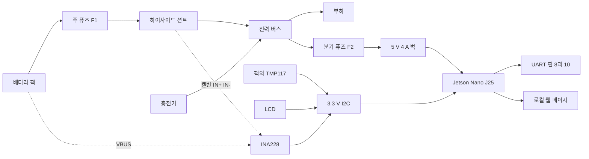
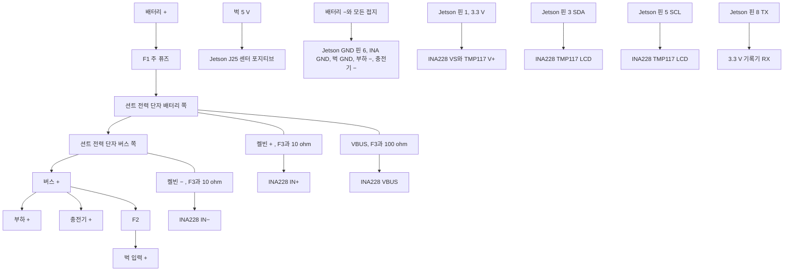

# Jetson Nano 배터리 충전·방전 모니터

[English](README.md) | [한국어](README.ko.md)

배터리 팩 하나의 전압, 양방향 전류, 부호 있는 전력, 누적 Ah·Wh, 충전 상태(SOC), 충전/방전/대기, 팩 온도, 남은 시간을 로컬에서 측정합니다. 제어기는 **NVIDIA Jetson Nano**(5 V 배럴 잭이 있는 개발자 키트)입니다. ESP32가 아니고, 로봇에 쓰인 Jetson Orin Nano도 아닙니다. Orin Nano의 배럴 전원 전압이 더 높으므로 이 문서의 5 V 전원부를 그대로 옮기지 않습니다.

팩의 화학 조성, 전압, 용량, 전류는 **알려져 있지 않습니다**. [`software/config/battery_profile.json`](software/config/battery_profile.json)에서 해당 항목은 null입니다. 팩 데이터시트로 채우기 전에는 실제 센서를 열지 않습니다. 그 값에 의존하는 부품은 [`bom/BOM.csv`](bom/BOM.csv)에서 BLOCKED입니다. 예시 파일의 숫자는 권장 팩이 아닙니다.

이 장치는 배터리 관리 장치(BMS)가 아닙니다. 셀 밸런스를 하지 않고 접촉기를 열지도 않습니다. 과전류를 끊는 것은 퓨즈입니다.

## 1. 권장 구조

팩 전류는 **배터리 양극 리드의 4단자 션트**로 재고, **TI INA228**이 읽습니다. 팩 전압을 모르기 때문에 버스 범위가 0 V~85 V인 INA228을 골랐습니다. INA226은 36 V에서 끝납니다. INA226을 고르면 팩이 36 V를 넘지 않는다고 추측하는 셈입니다. 감지 노드의 최고 전압이 85 V를 넘으면 INA228도 쓸 수 없습니다. 프로필 로더가 그 검사를 강제합니다.

Jetson은 팩 레일에 있지 않습니다. 션트의 부하 쪽에서 따로 퓨즈를 거친 벅 컨버터가 개발자 키트 배럴 잭용 5 V, 4 A를 만듭니다. 팩 전압은 Jetson 핀에 들어가지 않습니다. 션트가 팩 전압에 있어도 칩 전원은 Jetson 3.3 V 핀인 이유는 INA228의 공통 모드 범위 때문입니다.

팩 온도는 같은 3.3 V I2C 버스의 **TMP117**입니다. INA228 다이 온도는 칩 온도이지 셀 온도가 아닙니다. 20×4 I2C LCD와 Jetson의 로컬 웹 페이지가 같은 값을 보여 줍니다. 40핀 헤더 UART는 외부 기록기용으로 같은 행을 출력합니다. 클라우드 서비스는 없습니다.



### 센서 비교

| 방식 | 부품 | 범위 | 양방향 | 데이터시트 정확도 | 인터페이스 | 추가 부품 | 절연 | 결정 |
|---|---|---|---|---|---|---|---|---|
| 홀 센서 | Allegro ACS712 | ±5 A, ±20 A, ±30 A 버전. 전원 5.0 V | 예. 단방향 또는 양방향을 명시 | ±5 A 버전, 25 °C, ±5 A에서 총 출력 오차 1.5% | 아날로그 전압 | ADC. Jetson 40핀 헤더에는 없음. 5 V 전원도 필요 | 2.4 kVRMS, 핀 1–4와 핀 5–8 사이 | 사용하지 않음. 아날로그, 고정 범위, 5 V |
| 션트 모니터 | TI INA226 | 버스 0 V~36 V. 36 V를 넘기지 말 것. 션트 ±81.92 mV | 예. 하이사이드 또는 로우사이드 | 이득 오차 최대 0.1%, 션트 오프셋 최대 10 µV. 16비트 | I2C, 전원 2.7 V~5.5 V | 외부 션트 | 없음 | 사용하지 않음. 36 V가 이 팩보다 낮을 수 있음 |
| 션트 모니터 | TI INA228 | 공통 모드 −0.3 V~+85 V. 버스 0 V~85 V. 션트 ±163.84 mV 또는 ±40.96 mV | 예. 하이사이드 또는 로우사이드 | 션트 오프셋 최대 ±1 µV, 이득 오차 최대 ±0.05%. 20비트 | I2C, 전원 2.7 V~5.5 V | 외부 션트 | 없음 | **사용.** 팩이 85 V 이하일 때만 |
| 쿨롱 카운터 | ADI LTC2944 | 전원 3.6 V~60 V. 명시된 정확도는 감지 전압 ±50 mV | 예 | 25 °C, 감지 전압 10 mV~50 mV에서 총 전하 오차 ±1%, 전 온도 ±1.5% | I2C | 외부 션트 | 없음 | 사용하지 않음. 60 V에서 끝남 |
| 연료 게이지 | TI bq34z100-G1 계열 | 외부 분압과 프로그래밍된 화학 조성에 따름 | 외부 션트와 함께 예 | 여기에 숫자를 적지 않음. 원시 레지스터가 아니라 프로그래밍된 게이지 | 화학 데이터 프로그래밍 후 I2C | 션트, 분압, 화학 이미지 | 없음 | 사용하지 않음. 절차가 더 크고 화학 조성을 모름 |
| 개별 션트와 ADC | — | 분압과 ADC가 정함 | ADC가 양쪽 부호를 받을 때만 | ADC와 션트가 정함 | SPI 또는 아날로그 | ADC, 기준 전압, 분압 | 없음 | 사용하지 않음. 헤더에 ADC가 없어 INA228보다 부품이 늘어남 |

데이터시트: [INA228 SLYS021](https://www.ti.com/lit/ds/symlink/ina228.pdf), [INA226](https://www.ti.com/lit/ds/symlink/ina226.pdf), [ACS712](https://www.allegromicro.com/-/media/Files/Datasheets/ACS712-Datasheet.pdf), [LTC2944](https://www.analog.com/media/en/technical-documentation/data-sheets/2944fa.pdf), [TMP117](https://www.ti.com/lit/ds/symlink/tmp117.pdf). Jetson 헤더와 전원: [Jetson Nano Developer Kit User Guide](https://developer.nvidia.com/embedded/dlc/jetson-nano-developer-kit-user-guide).

## 2. 양방향 측정이 동작하는 방식

션트는 4단자 저항입니다. 팩 전류는 굵은 단자로 흐릅니다. INA228의 IN+와 IN−는 켈빈 감지 단자에만 연결되어, 전력 단자의 구리가 측정 저항에 섞이지 않습니다. TI 레이아웃 절이 이 접속을 요구합니다.

IN+는 션트의 **배터리** 쪽입니다. IN−는 **버스** 쪽(부하와 충전기)입니다. INA228은 IN+ − IN−를 변환합니다. 션트 전압이 양이면 배터리를 나가는 전류이고, 이 소프트웨어는 그것을 **방전**이라고 부릅니다. 음이면 배터리로 들어가는 전류, **충전**입니다. 감지선을 바꿔 꽂았으면 수식을 고치지 말고 프로필의 `invert_current`를 켭니다.

션트 하나는 **순** 배터리 전류를 잽니다.

`I_battery = I_load − I_charger`

충전기는 션트의 부하 쪽 버스에 연결해야 합니다. 그래야 충전 전류가 션트를 통해 팩으로 돌아가 집계됩니다. 션트의 배터리 쪽에 연결하면 충전 전류가 보이지 않습니다. 충전기와 부하가 동시에 있으면 상태는 순 전류의 부호를 따릅니다. Ah와 Wh는 여전히 팩의 합입니다. 연료 계량에는 그 합이 필요합니다. 충전 전류와 부하 전류를 나누려면 션트가 하나 더 필요하고, 그 션트는 달지 않습니다.

INA228의 POWER 레지스터는 부호가 없습니다. 부호 있는 전력은 소프트웨어에서 `V_bus × I_signed`로 계산합니다. 칩의 ENERGY와 CHARGE 레지스터는 INA228 전원이 떨어지면 지워지고 넘치면 되감깁니다. 저장 기록으로 쓰지 않습니다. Jetson이 전류와 전력을 적분해 저장합니다.

대기, 충전, 방전은 잡음보다 높고 관심 있는 최소 전류보다 낮은 문턱 `idle_current_a`로 나눕니다.

- `I > idle` → 방전
- `I < −idle` → 충전
- 그 밖 → 대기

### 하이사이드. 로우사이드가 아닌 이유

션트는 양극 리드에 둡니다.

로우사이드 션트는 귀로에 있습니다. 모든 부하와 충전기가 그 션트로 돌아와야 하고, 다른 접지 경로는 션트를 우회합니다. 또 부하 접지가 팩 음극보다 `I × R`만큼 떠서 Jetson 접지, 벅 접지, 충전기 접지가 그 강하만큼 어긋납니다.

하이사이드 션트는 팩 음극을 Jetson, 벅, 충전기, 부하의 공통 접지로 남겨 둡니다. INA228은 그 배치를 지원합니다. 칩 전원이 2.7 V~5.5 V여도 공통 모드는 85 V까지이고, 데이터시트는 칩 전원이 꺼져 있어도 버스 전압이 있을 수 있다고 적습니다. 버스에서 접지로의 단락도 션트를 통과합니다.

## 3. 부품

아래 전기 수치는 인용한 데이터시트의 값입니다. 모듈 판매 문구가 아닙니다.

### INA228 (TI SLYS021)

| 항목 | 값 |
|---|---|
| 전원 VS | 2.7 V~5.5 V. 이 설계는 Jetson 3.3 V |
| 대기 전류 | 25 °C, VSENSE = 0에서 통상 640 µA, 최대 750 µA |
| 공통 모드 | −0.3 V~+85 V |
| 버스 전압 | 0 V~85 V, LSB 195.3125 µV |
| 션트 범위 | ±163.84 mV (ADCRANGE = 0) 또는 ±40.96 mV (ADCRANGE = 1) |
| 션트 LSB | 312.5 nV 또는 78.125 nV |
| 오프셋 | 션트 최대 ±1 µV |
| 이득 오차 | 션트와 버스 모두 최대 ±0.05% |
| 입력 바이어스 | 85 V에서 어느 IN 핀이든 통상 0.1 nA, 최대 2.5 nA |
| 차동 임피던스 | 통상 92 kΩ |
| VBUS 임피던스 | 동작 중 최소 0.8 MΩ, 통상 1 MΩ, 최대 1.2 MΩ |
| 다이 온도 | 25 °C에서 최대 ±1 °C, −40 °C~125 °C에서 최대 ±2 °C. 팩 온도가 아님 |
| 논리 High | 1.2 V~5.5 V. 3.3 V 버스가 유효 |
| 절대 최대 | VS 6 V, IN 공통 모드 85 V, SDA/SCL 6 V, 어느 핀이든 유입 전류 5 mA |
| 식별 | 제조사 0x5449, 장치 0x2281 |
| 주소 | A1과 A0가 GND일 때 0x40. 여기서 쓰는 브레이크아웃 기본값 |

IN+, IN−, VBUS가 나온 브레이크아웃을 씁니다. 예: [Adafruit INA228](https://learn.adafruit.com/adafruit-ina228-i2c-power-monitor). 그 안내에는 핀 이름, VIN으로 묶인 10 kΩ 풀업, 외부 션트의 하이사이드 배선이 있습니다. VIN은 Jetson 핀 1(3.3 V)에 댑니다. VIN이 5 V이면 10 kΩ이 Jetson I2C 핀을 5 V 쪽으로 당깁니다. 그렇게 하지 않습니다. 팩 전류는 브레이크아웃 기판을 지나지 않습니다.

프로필이 `adc_range_mv`를 40.96으로 두지 않는 한 ADCRANGE = 0(±163.84 mV)입니다. 평균은 128이고 변환 시간은 버스, 션트, 다이 온도 모두 1052 µs입니다. 그 설정에서 세 변환의 레지스터 갱신 간격은 약 404 ms입니다.

### 션트

선정하지 않았습니다. 저항, 전류 정격, 전력 정격은 팩 전류와 션트 데이터시트에서 옵니다.

`R_shunt < 0.16384 V / I_max`

`I_max`는 최대 충전 전류와 최대 방전 전류 중 큰 값입니다. `I_max × R`이 풀스케일을 넘으면 로더가 프로필을 거부하고, 풀스케일의 90%를 넘으면 경고합니다. 손실은 `I² × R`이며 션트 자체의 연속 정격 안에 있어야 합니다. 열이 빠지는 곳에 션트를 답니다. 전력 단자가 아니라 감지 단자가 INA228로 갑니다.

### TMP117 (TI SNOSD82)

| 항목 | 값 |
|---|---|
| 정확도 | −20 °C~50 °C에서 최대 ±0.1 °C, 교정 없음 |
| 분해능 | 0.0078125 °C (1/128 °C) |
| 전원 | 전 온도에서 1.8 V~5.5 V. 3.3 V를 사용 |
| I2C | 최대 400 kHz. ADD0가 GND이면 주소 0x48 |
| 입력 High | 0.7 × V+. 3.3 V이면 2.31 V |
| 핀 | 권장 I/O 전압은 5.5 V까지. 버스의 Jetson 쪽은 여전히 3.3 V |
| 장치 ID | 레지스터 0x0F가 0x0117 |

INA228 기판이 아니라 팩에 붙입니다. Adafruit TMP117 브레이크아웃(제품 4821)을 쓸 수 있습니다. 위 한계는 TI 한계입니다.

### LCD

PCF8574 백팩이 달린 20×4 HD44780 계열 모듈입니다. 드라이버는 흔한 백팩 배치를 가정합니다. P0 RS, P1 RW, P2 E, P3 백라이트, P4–P7 데이터. 주소는 보통 0x27 또는 0x3F이니 확인하고 `lcd_address`에 넣습니다. 모듈이 20칸이라 LCD는 짧은 코드(CHG, DIS, IDLE, FAULT)를 씁니다. 웹 페이지는 전체 단어를 씁니다.

레벨 시프터가 필요한지는 4절입니다. 3.3 V와 5 V 중 무엇을 쓸지는 모듈 데이터시트의 Vdd로 확인합니다.

### Jetson Nano

개발자 키트 사용자 설명서 기준입니다. 배럴이 J25인 키트이며, 2GB 키트도 Orin도 아닙니다.

| 항목 | 값 |
|---|---|
| 배럴 J25 | 부하가 필요할 때 5 V, 4 A 전원. 센터 포지티브, 2.1 mm × 5.5 mm, 플러그 길이 9.5 mm. 이 잭의 지원 연속 전류 최대는 설명서에 4.4 A |
| J48 | 점퍼를 끼워 배럴을 전원으로 하고 Micro-USB는 전원이 아니게 함 |
| 모듈 입력 | 커넥터에서 최소 4.75 V |
| 헤더 | J41, 40핀. 신호 핀은 3.3 V |
| I2C | 핀 3과 5가 I2C1, 보통 `/dev/i2c-1`. 핀 27과 28은 I2C0이고 카메라와 공유 |
| UART | 핀 8과 10이 `/dev/ttyTHS1` |
| 금지 | J25와 헤더 5 V 핀으로 동시에 전원을 넣지 말 것 |

이 캐리어들의 I2C 헤더 핀은 2.2 kΩ으로 3.3 V에 풀업되고 모듈로 갑니다. TXB0108을 거치지 않습니다. UART와 그 밖의 비-I2C 신호는 TXB0108을 거칩니다. TXB0108 출력은 약합니다(캐리어 핀 주석에 약 20 µA). 짧은 3.3 V UART 케이블은 됩니다. 그 핀에 낮은 값의 풀업을 달지 않습니다.

### USB-I2C 어댑터

헤더 버스가 기본이고 어댑터가 필요 없습니다. 핀 3과 5를 이미 쓰고 있을 때의 대안입니다.

**i2c-tiny-usb** 프로토콜 어댑터는 리눅스 `i2c-tiny-usb` 드라이버에 묶여 `/dev/i2c-N`으로 나타납니다. `N`은 커널이 정하고 다시 꽂으면 바뀔 수 있습니다. `i2c_bus`를 그 경로로 둡니다. `i2cdetect -l`로 확인합니다.

드라이버는 커널에 들어온 지 오래입니다. Nano의 JetPack 4.6 커널은 4.9이고 NVIDIA 설정에 `CONFIG_I2C_TINY_USB`가 없을 수 있습니다. `zcat /proc/config.gz | grep I2C_TINY_USB`로 확인합니다. 옵션이 없으면 헤더의 `/dev/i2c-1`을 씁니다.

어댑터의 I2C 쪽이 TMP117, INA228과 같은 버스이면 3.3 V여야 합니다. 헤더와 동시에 연결하지 않습니다. 마스터가 둘이거나 Jetson 핀에 5 V 풀업이 있으면 배선 오류입니다. 두 마스터 사이의 소프트웨어 차이는 `i2c_bus` 문자열뿐입니다.

### 벅, 퓨즈, 함체

벅은 BLOCKED입니다. 5.0 V~5.25 V를 4 A 연속으로 내고, 입력 범위는 방전 하한부터 충전기가 버스에 올릴 수 있는 최고 전압까지를 포함해야 합니다. 그 전압을 모르므로 부품 번호를 적지 않습니다. NVIDIA가 검증한 GEO241DA-0540 전원은 배럴 규격을 만족하는 AC 어댑터입니다. 배터리용 벅이 아니고 이 조립에 포함되지 않습니다.

퓨즈와 전선 굵기는 안전 절에 있습니다. 인쇄용 함체는 [11절](#11-함체)에 있습니다. 션트는 함체 밖에 둡니다.

## 4. 연결과 측정

### 배선



SOC에 쓰는 전압이 팩 단자 전압이 되도록 VBUS는 션트의 배터리 쪽에서 가져옵니다. 버스 쪽과의 차이는 션트 강하이고 164 mV 미만입니다.

### 핀과 연결

| 기능 | Jetson Nano J41 | 반대편 | 레벨 |
|---|---|---|---|
| 3.3 V | 핀 1 | INA228 VIN, TMP117 V+, LCD가 3.3 V일 때 LCD | 3.3 V. 이 핀으로 Jetson에 전원을 넣지 않음 |
| I2C1 SDA | 핀 3, `/dev/i2c-1` | INA228 SDA, TMP117 SDA, LCD SDA | 3.3 V 오픈 드레인 |
| I2C1 SCL | 핀 5 | INA228 SCL, TMP117 SCL, LCD SCL | 3.3 V 오픈 드레인 |
| 접지 | 핀 6 | INA228 GND, 센서 GND, UART GND, 벅 접지, 배터리 음극 | 공통 접지. 절연 아님 |
| UART TX | 핀 8, `/dev/ttyTHS1` | 외부 3.3 V RX | 3.3 V, 구동이 약함 |
| UART RX | 핀 10 | 외부 3.3 V TX, 선택 | 3.3 V |
| 접지 | 핀 9 | 핀 6을 다른 데 쓸 때의 UART 접지 | |
| I2C0 | 핀 27과 28, 보통 `/dev/i2c-0` | 카메라가 있으면 쓰지 않음 | 헤더의 대체 버스 |
| 5 V 입력 | J25 배럴, J48 장착 | 벅 출력, 센터 포지티브 | 5 V, 4 A를 낼 수 있어야 함 |
| 헤더 5 V | 핀 2와 4 | Jetson 전원으로 쓰지 않음 | J25와 동시에 전원을 넣지 않음 |
| USB | J32 또는 J33 | 헤더 버스를 쓰지 않을 때만 i2c-tiny-usb | 어댑터 I2C 쪽은 3.3 V |
| 션트 켈빈 + | — | INA228 IN+, 배터리 쪽, F3과 10 Ω 경유 | 팩 전압 |
| 션트 켈빈 − | — | INA228 IN−, 버스 쪽, F3과 10 Ω 경유 | 팩 전압 |
| VBUS | — | 배터리 쪽에서 INA228 VBUS, F3과 100 Ω 경유 | 0 V~85 V |

### I2C 레벨 시프터

INA228과 TMP117에는 레벨 시프터가 없습니다.

두 칩 모두 3.3 V로 전원을 공급하면 3.3 V High를 받습니다. INA228 논리 High 최소는 1.2 V입니다. TMP117 논리 High 최소는 0.7 × V+입니다. 캐리어가 이미 SDA와 SCL을 2.2 kΩ으로 3.3 V에 당깁니다. Adafruit INA228은 VIN에 10 kΩ을 더합니다. VIN이 3.3 V이면 병렬은 약 1.8 kΩ이고, 패스트 모드 풀업으로 정상입니다. 여기에 시프터를 넣으면 할 일이 없는 부품이 됩니다.

5 V LCD 백팩만 시프터가 필요합니다. 풀업이 5 V에 있고 Jetson I2C 핀은 5 V 버스가 아닙니다. 둘 중 하나입니다.

- 모듈 데이터시트가 그 Vdd를 허용하고 대비가 되면 백팩을 핀 1에 대고 시프터를 빼거나
- 백팩을 5 V에 대고, NXP AN10441처럼 BSS138 양방향 시프터를 백팩과 Jetson 사이에 둡니다. 낮은 쪽은 3.3 V, 높은 쪽은 5 V입니다. INA228과 TMP117은 3.3 V 쪽에 남습니다.

5 V LCD를 버스 전체를 5 V로 당겨서 해결하지 않습니다.

### 소프트웨어가 재는 것

매 샘플마다 드라이버는 제조사 0x5449와 장치 0x2281을 확인하고, 프로필의 전류 한계와 션트 저항으로 `SHUNT_CAL`을 쓰며, VBUS, CURRENT, 진단 레지스터를 읽습니다. 같은 버스에서 TMP117 온도 레지스터를 읽습니다. 프로필의 교정 이득과 오프셋은 원시 변환 뒤에 적용됩니다. 적분은 그 교정된 전류를 씁니다. I2C 트랜잭션이 실패하면 COMMS 고장이 되고 그 스텝의 Ah는 **더하지 않습니다**.

I2C 버스 경로는 프로필의 `i2c_bus`입니다. `/dev/i2c-1`이 헤더 기본값입니다.

## 5. 설계 문제와 해결

| 문제 | 처리 |
|---|---|
| 팩 전압을 모름 | INA228, 85 V 풀스케일. `max_voltage_v`가 85를 넘으면 로더가 거부. 벅, 주 퓨즈, 전선 굵기는 BLOCKED |
| 팩 전류를 모름 | 션트 저항은 프로필 항목. 한계는 `0.16384 / I_max`. 저항을 권장하지 않음 |
| 단방향 센서는 충전을 숨김 | IN+ / IN− 극성. 음전류가 충전. 테스트가 양쪽 부호를 확인 |
| 충전과 부하가 동시에 | 하이사이드 션트 하나가 순 팩 전류를 읽음. 연료 계량의 입력으로 맞음. 두 전류를 나누지는 않음 |
| INA228 전력 레지스터에 부호가 없음 | 소프트웨어 전력은 부호 있는 전류로 `V × I` |
| 칩의 에너지·전하가 전원 상실 때 지워짐 | 원자적 JSON 파일의 소프트웨어 적분. 꺼져 있던 구간은 채우지 않음 |
| 긴 정지가 Ah를 만들어 냄 | 스텝이 `max_integrate_dt_s`(기본 5 s)보다 길면 표시만 하고 적분하지 않음 |
| 쿨롱 적산이 흐름 | 휴지 중, 이 화학 조성의 OCV 표를 넣었을 때만 휴지마다 SOC를 한 번 그 표로 맞춤. 표가 없으면 전압으로 SOC를 추측하지 않음 |
| Jetson 헤더에 ADC가 없음 | 아날로그 홀 센서를 제외. I2C만 사용 |
| 5 V와 3.3 V | 센서는 3.3 V. 시프터는 5 V LCD일 때만 |
| 헤더 I2C를 이미 쓸 수 있음 | 경로로 고르는 i2c-tiny-usb 어댑터. 헤더와 병렬하지 않음 |
| UART 구동이 약함 | 로그만, 짧은 3.3 V 케이블, 추가 풀업 없음 |
| 플래시 마모 | 상태 JSON은 매 샘플이 아니라 `persist_interval_s`(기본 30 s)와 종료 때에만 다시 씀. 이력은 별도 간격의 SQLite 추가 |
| 보호 회로가 아님 | 끊는 것은 퓨즈. 소프트웨어 고장은 LCD, UART, 웹의 경보 |

## 6. 안전

이 센서는 절연이 아닙니다. 배터리 음극, Jetson 접지, INA228 접지, 벅 접지, 충전기 음극, 부하 음극은 한 노드입니다. 배선 오류는 그 노드나 감지선에 팩 전압을 올립니다. ACS712 같은 홀 절연은 이 회로에 없습니다.

### 전력 경로와 전자 회로 경로

팩 전류는 케이블, 주 퓨즈, 션트 소자, 버스에 머뭅니다. Jetson은 벅의 5 V 출력이 J25로 들어갈 뿐입니다. INA228이 팩 전압을 보는 핀은 그 전압을 정격으로 갖는 IN+, IN−, VBUS이고, VS와 I2C 핀은 3.3 V입니다.

팩 도체를 Jetson 헤더 핀에 대지 않습니다. J25와 헤더 핀 2/4에 동시에 전원을 넣지 않습니다.

### 퓨즈

| 퓨즈 | 위치 | 정격 |
|---|---|---|
| F1 | 배터리 양극, 션트 앞, 셀에 최대한 가깝게 | 전선 허용 전류 이하, 팩 제조사 한계 이내. 전류를 모르므로 BLOCKED. 전압 정격은 최고 버스 전압을 넘어야 함 |
| F2 | 션트 부하 쪽, 벅 입력 리드 | 가장 낮은 팩 전압에서의 벅 입력 전류보다 높고, 그 분기 전선 허용 전류보다 낮음. 벅과 팩 전압이 정해지기 전에는 BLOCKED |
| F3 | 신호 퓨즈 세 개. IN+ 켈빈, IN− 켈빈, VBUS. 각 선의 션트 끝 | 100 mA. 이 선들의 정상 전류는 팩 전류가 아니라 INA228 바이어스(최대 2.5 nA)이기 때문. 전압 정격은 팩 전압을 넘어야 하며 BLOCKED |

### 켈빈 저항

각 감지선에 10 Ω, INA228 바로 옆. VBUS 선에 100 Ω.

차동 임피던스 통상값은 92 kΩ입니다. 10 Ω 두 개의 이득은 `92000 / (92000 + 20)`, 약 0.99978입니다. 교정 전 오차 약 0.022%입니다. 92 kΩ은 한계가 아니라 통상값이므로 소프트웨어가 이 식으로 보정하지 않습니다. 실제 이득은 교정이 잽니다.

VBUS 임피던스는 최소 0.8 MΩ입니다. 100 Ω 직렬 저항은 그 최소값에 대해 0.0125% 분압입니다.

이 저항은 감지선이 접지에 단락했을 때 핀 전류를 절대 최대 5 mA 안에 넣지 **못합니다**. 팩 전압을 모르면 `V / 10 Ω`은 5 mA를 훨씬 넘습니다. 그 고장을 여는 것은 F3입니다. 저항은 칩 옆에 작고 짝이 맞는 직렬 소자를 두어, 이득 오차가 교정이 지울 수 있는 크기로 남게 합니다.

### 전선 굵기

팩 전류를 알게 된 뒤, 설치에 적용되는 규정으로 고릅니다. 보수적인 확인으로 NEC Table 310.16(NFPA 70) 60 °C 열의 구리 허용 전류는 다음과 같습니다.

| AWG | 60 °C 구리 |
|---|---|
| 14 | 15 A |
| 12 | 20 A |
| 10 | 30 A |
| 8 | 40 A |
| 6 | 55 A |
| 4 | 70 A |
| 3 | 85 A |
| 2 | 95 A |
| 1 | 110 A |
| 1/0 | 125 A |
| 2/0 | 145 A |
| 3/0 | 165 A |
| 4/0 | 195 A |

표는 14 AWG보다 가는 선을 싣지 않습니다. Jetson 배럴 회로는 4 A이므로 14 AWG는 이 열을 여유 있게 만족합니다. 팩 주 도체는 여기서 정하지 않습니다. F1은 실제로 깐 전선의 허용 전류 이하여야 합니다. 감지선은 전류가 나노암페어라 22 또는 24 AWG 꼬임쌍선입니다. 그것들을 보호하는 것은 허용 전류 표가 아니라 F3입니다.

### 역극성

팩 주 리드에 직렬 다이오드를 넣지 않습니다. 그 리드는 충전과 방전을 양쪽 방향으로 흘려야 하고, 이 전류의 다이오드는 발열이 됩니다.

INA228 공통 모드 절대 최대는 −0.3 V입니다. 팩을 반대로 연결하면 IN+, IN−, VBUS가 그 한계 밖이 되어 칩이 깨질 수 있습니다. 10 Ω은 역접속을 안전하게 만들지 않습니다. 팩을 반대로 연결하지 않습니다.

벅을 고를 때 그 입력에는 팩 전압과 벅 입력 전류를 견디는 역극성 보호가 따로 필요합니다. 그 부품은 벅과 함께 BLOCKED입니다. 배럴 잭은 센터 포지티브입니다.

### 과전류와 전압

끊는 것은 F1입니다. 소프트웨어는 측정값을 `max_discharge_current_a`, `max_charge_current_a`, `max_voltage_v`, `min_voltage_v`와 비교해 경보를 올립니다. 스스로 고장을 해제하지 않고 팩을 차단하지도 않습니다. 션트 전압이 ADC 풀스케일에 닿으면 측정이 잘리고 `SHUNT_SATURATED`가 올라갑니다. 잘린 전류를 실제 피크로 다루지 않습니다.

온도 경보는 셀 데이터시트에서 `temp_min_c`와 `temp_max_c`를 둘 다 넣었을 때만 동작합니다. 그렇지 않으면 일부러 꺼져 있습니다.

## 7. 수식

`I`는 방전이 양입니다. `dt`는 유효한 샘플의 초입니다. 시작 뒤 첫 샘플은 0이고, 간격이 `max_integrate_dt_s`보다 길어도 0입니다.

```
P = V × I
Ah_out += I × dt / 3600
Wh_out += P × dt / 3600
```

`Ah_out`과 `Wh_out`은 부호가 있습니다. 충전이면 더 음이 됩니다.

저장된 기준 `(SOC_anchor, Ah_anchor)`가 있으면:

```
remaining_Ah = capacity_Ah × SOC_anchor / 100 − (Ah_out − Ah_anchor)
SOC = remaining_Ah / capacity_Ah × 100
```

표시 SOC는 0–100으로 제한합니다. 저장된 적분기는 제한하지 않아서, 이후 충전이 끝값에 붙들리지 않습니다. 기준도 저장 상태도 없으면 SOC는 미지입니다. Ah는 그래도 누적됩니다. 소프트웨어가 시작 퍼센트를 만들지 않습니다.

휴지에서 `|I|`가 `rest_current_a`(없으면 `idle_current_a`) 이하로 `rest_duration_s`(기본 300 s) 동안 이어지고, OCV 두 열이 채워져 있을 때만:

```
SOC_ocv = interpolate(휴지 평균 전압, ocv_voltage_v, ocv_soc_percent)
```

그다음 기준을 그 SOC와 당시의 `Ah_out`으로 둡니다. 휴지 한 번당 보정은 한 번입니다. 표 밖의 전압은 연장하지 않습니다.

방전 중 남은 시간은 `max(remaining_Ah, 0) / I`입니다. 충전 중 완충까지는 `(capacity_Ah − remaining_Ah) / |I|`이고, 계정이 이미 완충 이상이면 0입니다. 대기에는 시간 추정이 없습니다.

INA228 교정, 데이터시트 식 2와 3, ADCRANGE = 0:

```
CURRENT_LSB = I_expected_max / 2^19
SHUNT_CAL = 13107.2 × 10^6 × CURRENT_LSB × R_shunt
```

ADCRANGE = 1이면 `SHUNT_CAL`에 4를 곱합니다. `I_expected_max`는 명판 전류 중 큰 값입니다. 드라이버는 15비트 레지스터에 들어가도록 `CURRENT_LSB`를 최대 8배까지 두 배 할 수 있고, 데이터시트가 이를 허용합니다. 암페어 전류는 `CURRENT_LSB ×` 부호 있는 20비트 CURRENT 필드입니다. 8.2절의 계산 예(10 A, 16.2 mΩ, 레지스터 4050, 코드 314572에서 6 A)는 단위 테스트입니다.

칩 측정 뒤에 적용하는 교정:

```
V = voltage_gain × V_raw + voltage_offset_v
I = current_gain × I_raw + current_offset_a
```

`invert_current`는 그 다음 `I`의 부호를 바꿉니다. 칩은 이미 `SHUNT_CAL`로 `R_shunt`를 적용했습니다. 소프트웨어 이득은 교정 절차의 잔차뿐입니다.

적분은 INA228 평균(128샘플)을 씁니다. 적분기 앞에 추가 지수 필터는 없습니다. 느린 표시 필터는 Ah 합을 기울입니다.

## 8. 교정

실제 션트를 단 상태에서 합니다. 4선 측정이 가능하면 프로필의 `shunt_resistance_ohm`은 릴 표기가 아니라 측정 저항으로 둡니다.

1. **영전류.** 부하와 충전기를 엽니다. 보고된 전류를 평균합니다. 교정 전류가 0이 되도록 `current_offset_a`를 둡니다. 이득이 기본 1이면 오프셋은 그 평균의 음수입니다.
2. **전압.** 배터리 단자의 교정된 계측기와 보고 전압을 비교합니다. `voltage_gain`과 필요하면 `voltage_offset_v`를 둡니다.
3. **전류.** 알고 있는 정상 부하와 직렬로 계측기를 넣습니다. 오프셋을 넣은 뒤 `current_gain`을 `I_meter / I_raw`로 둡니다. 충전 전류에서도 반복하고 부호를 확인합니다.
4. **극성.** 방전은 양전류여야 합니다. 아니면 감지선을 바꾸거나 `invert_current`를 켠 다음 영점을 다시 봅니다.
5. **용량.** 알고 있는 전류로 완전 방전하면 명판 `capacity_ah`를 측정값으로 바꿀 수 있습니다. 명판 값이 시작점입니다. 이 절차가 용량을 만들어 내지 않습니다.
6. **OCV 표.** 여러 충전 상태에서 팩을 쉬게 하고 단자 전압을 적어 `ocv_voltage_v`와 `ocv_soc_percent`를 채웁니다. 표는 측정한 화학 조성과 온도에서만 유효합니다. 측정 전에는 비워 둡니다. 빈 표는 OCV 보정을 끕니다.
7. **온도 한계.** 경보가 필요하면 셀 데이터시트에서 `temp_min_c`와 `temp_max_c`를 옮깁니다.

프로필을 저장하고 서비스를 다시 시작한 뒤, 영전류 측정이 대기 구간 안에 있는지 확인합니다.

## 9. 시험과 고장 찾기

`software/`에서 Python 3.9 이상:

```bash
python3 -m venv .venv
. .venv/bin/activate
pip install -r requirements-dev.txt
pytest
python -m battery_monitor --simulate --duration 2 --no-web
python -m battery_monitor --check-profile --config config/battery_profile.json
```

`pytest`는 하드웨어가 필요 없습니다. 데이터시트 수치 예, 전류 양쪽 부호, Wh 부호, 쿨롱 SOC, 휴지당 OCV 보정 한 번, 표 밖을 연장하지 않음, Ah가 늘지 않는 통신 두절, 적분하지 않는 긴 간격, 상태 파일에서의 재시작, LCD·UART 형식, 대시보드 페이지를 확인합니다. `--simulate`는 시뮬레이션이라고 표시된 가짜 팩의 방전/대기/충전 파형입니다. 동봉 프로필에 대한 `--check-profile`은 0이 아닌 코드로 끝나고 빠진 항목을 나열합니다.

프로필이 실제 값이 된 뒤 Jetson에서:

| 확인 | 보여야 하는 것 |
|---|---|
| `i2cdetect -y 1` | 0x40 (INA228)과 0x48 (TMP117). LCD는 그 주소 |
| 식별 | INA228이 0x5449 / 0x2281로 답하지 않거나 TMP117이 0x0117로 답하지 않으면 서비스가 종료 |
| 부호 | 부하는 양전류와 양전력. 부하가 꺼진 충전기는 음전류 |
| 대시보드 | LAN의 `http://<jetson>:8080`. 페이지에 외부 자원이 없음 |
| UART | `/dev/ttyTHS1`, 115200, 3.3 V의 CSV 한 줄 |
| 전원 차단 | 재부팅 후 SOC와 Ah가 마지막 저장과 같고, 페이지는 꺼져 있던 시간을 세지 않았다고 표시 |

| 증상 | 볼 곳 |
|---|---|
| 프로필 거부 | 명판 항목이 null이거나 `max_voltage_v`가 85를 넘거나 션트 강하가 163.84 mV를 넘음. `--check-profile` |
| COMMS이고 Ah가 변하지 않음 | 버스 번호, 브레이크아웃 VIN의 3.3 V, 주소 핀, Jetson과 싸우는 5 V 풀업, 또는 USB 어댑터와 헤더를 둘 다 연결 |
| 부하가 분명한데 전류가 0 | 션트 우회, 잘못된 단자의 켈빈선, 또는 프로필 실패로 `SHUNT_CAL`이 쓰이지 않음 |
| 부호가 반대 | 감지선이 바뀜. 선을 고치거나 `invert_current`를 켠 뒤 영점을 다시 |
| 휴지에 SOC가 튐 | OCV 표가 이 팩과 다름. 측정 전에는 표를 비움 |
| SOC가 빈칸 | `initial_soc_percent`가 null이고 휴지 보정이 없었음. Ah는 유효 |
| LCD가 꺼지고 버스가 죽음 | 시프터 없이 Jetson에 묶인 5 V 백팩 |
| UART가 깨지거나 없음 | 5 V USB-UART, TXB0108의 긴 케이블, 또는 핀 8·10이 아닌 버튼 헤더의 콘솔 UART |
| 웹 페이지가 안 열림 | 서비스는 `web_host`(기본 `0.0.0.0`)와 `web_port`(기본 8080)에 바인드. 인증이 없음. 포트를 공개 인터넷으로 열지 말 것. Nano의 Wi-Fi는 동글이나 M.2 카드가 필요하고, 액세스 포인트는 그 인터페이스의 NetworkManager 또는 hostapd 설정이며 이 서비스가 띄우지 않음 |

대시보드 열은 Voltage V, Current A, Power W, SOC %, Capacity Ah(SOC를 알 때의 남은 Ah), Energy Wh(밖으로 나간 부호 있는 Wh), Status, Temperature C입니다. 충전, 방전, 대기, 고장은 색이 다릅니다. 시뮬레이션은 팩 측정으로 오인하지 않도록 배너를 냅니다.

## 10. 필요한 배터리 사양

셀 또는 팩 데이터시트에서 아래를 `software/config/battery_profile.json`으로 옮기기 전에는 하드웨어를 시작하지 않습니다.

| 항목 | 옮길 내용 | null로 두면 |
|---|---|---|
| `chemistry` | 화학 조성 이름 | 실제 센서를 거부. 나중에 넣는 OCV도 이 화학 조성과 맞아야 함 |
| `nominal_voltage_v` | 팩 공칭 전압 | 거부 |
| `max_voltage_v` | 감지 노드의 최고 전압. 만충전 팩 전압과 충전기 전압 중 높은 쪽 | 거부. INA228 85 V 한계의 가부 판정이기도 함 |
| `min_voltage_v` | 방전 컷오프 | 거부. 저전압 경보이자 벅 입력의 하단 |
| `capacity_ah` | SOC에 쓸 용량, Ah | 거부 |
| `max_charge_current_a` | 최대 충전 전류 | 거부 |
| `max_discharge_current_a` | 최대 방전 전류 | 거부 |

명판 숫자는 아니지만, 센서를 열기 전에 필요하고 명판 전류를 알기 전에는 정할 수 없는 항목입니다.

| 항목 | 의존 |
|---|---|
| `shunt_resistance_ohm` | `I_max`. 163.84 mV 범위에서 `0.16384 / I_max` 옴 미만 |
| `shunt_rated_current_a` 또는 `shunt_rated_power_w` | 션트 데이터시트. `I_max`와 `I_max² × R`에 대해 검사 |
| `idle_current_a` | 잡음과, 충전 또는 방전으로 볼 최소 전류. 두 전류 한계보다 낮아야 함 |
| `initial_soc_percent` | 선택. 없으면 휴지 보정 전까지 SOC는 미지. 추측하지 않음 |
| `ocv_voltage_v`, `ocv_soc_percent` | 선택. 화학 조성별. 비어 있으면 OCV 보정이 꺼짐 |
| `temp_min_c`, `temp_max_c` | 선택. 셀 데이터시트에서 둘 다, 또는 둘 다 null |

위 표가 채워지기 전까지 BOM에서 BLOCKED인 정격:

| 정격 | 의존 |
|---|---|
| 션트 저항과 전력 정격 | 최대 충전·방전 전류 |
| F1 전류 | 최대 방전 전류, 전선 허용 전류, 팩 한계 |
| 팩 전선 굵기 | 최대 전류. 안전 절의 표를 하한으로 사용 |
| 벅 컨버터 | 최소·최대 버스 전압, 출력 5 V 4 A |
| F2 전류 | 벅 입력 전류. 팩 전압과 벅 효율에 의존 |
| F3 전압 정격 | 최대 버스 전압 |
| 이 설계를 써도 되는지 | `max_voltage_v` ≤ 85 |

`config/examples/example_DO_NOT_USE.json`과 시뮬레이터 내부 프로필은 파일 모양과 테스트를 위한 가짜 숫자입니다. `example_only`로 표시되어 있고 하드웨어 경로는 거부합니다.

## 11. 함체

션트는 상자 밖에 둔다. 발열은 `I²R`이고 팩 전류를 아직 모르므로 수 와트일 수 있다. 상자는 플라스틱이고 Jetson 방열판의 열도 빠져야 한다. INA228 감지 입력은 팩 전류를 흘리지 않으므로 켈빈 쌍과 VBUS 선만 안으로 들어온다. 퓨즈 홀더는 상자 안, 배터리 양극에서 션트로 나가는 선 앞에 둔다. 셀에서 상자까지 케이블이 길면 실제 퓨즈는 셀 가까이에 둔다. 긴 리드의 끝에 있는 퓨즈는 그 리드를 보호하지 못한다.


바깥 치수 **213.9 × 170.1 × 55.1 mm**. 안쪽 공간 **208.9 × 165.1 × 49.6 mm**. 벽 2.5 mm, 바닥 3.0 mm, 뚜껑 2.5 mm. 끼워맞춤은 면마다 0.25 mm 여유다. 글랜드 구멍은 카탈로그 지름에 면마다 0.20 mm를 더한다. 인쇄한 구멍은 작게 나오기 때문이다. 이 여유는 보드 끼워맞춤과 별개다.

| 위치 | 내용 | 근거 |
|---|---|---|
| 남서쪽, 8 mm 선반 위 | Jetson Nano 개발자 키트, 100 × 80 × 29 mm 외곽 | NVIDIA 개발자 키트 데이터시트, 2020년 1월. 키트 구성에 방열판이 달린 모듈이 포함된다. 그 시트에 장착 구멍 좌표가 없으므로 외곽으로 받친다. P3449 설계 파일이나 P3450 STEP에서 구멍을 재기 전까지 스크립트의 `JETSON_HOLE_XY`는 비어 있다. |
| 키트 쪽 남쪽·서쪽 벽 | 배럴 잭, USB, 이더넷, HDMI용 개구 | 사용자 설명서는 커넥터 목록만 있고 위치는 없다. 필요한 커넥터가 이 두 변을 향하게 키트를 돌린다. |
| 뚜껑, 키트 동쪽 | Winstar WH2004A 20×4, 창 75.0 × 23.2 mm | 모듈 98.0 × 60.0 × 13.6 mm MAX, 표시 영역 77.0 × 25.2 mm, Ø2.5 구멍 4개, 피치 93.0 × 55.0 mm. 창은 표시 영역보다 면마다 1 mm 작다. |
| LCD 아래 바닥 | INA228 브레이크아웃과 USB-I2C 어댑터 | INA228 PCB와 구멍은 Adafruit Eagle 보드에서 읽었다. 어댑터 크기는 검증되지 않은 외곽이다. |
| 북쪽 칸 | 주 퓨즈, 5 V 4 A 벅, 단자대 두 개 | 외곽만 있다. 팩 전압과 전류를 모르므로 카탈로그 부품을 고르지 않았다. |
| 북쪽 벽 | 글랜드 구멍 여덟 개 | 아래 목록. |

상자 안 전력 경로: 배터리 양극이 들어와 퓨즈를 지나 외부 션트의 배터리 쪽으로 나간다. 션트의 버스 쪽이 돌아오고, 단자대가 부하, 충전기, 벅 입력으로 나눈다. 벅의 5 V 출력은 안에 남아 J25에 꽂힌다. IN+, IN−, VBUS는 작은 글랜드를 쓴다.

글랜드는 북쪽 벽, 서쪽에서 동쪽 순이다. 인쇄 지름은 LAPP T21 판 구멍에 면마다 0.20 mm를 더한 값이다. 구멍은 물방울 모양이어서 위쪽이 45도로 브리지된다.

| 글랜드 | 나사 | 카탈로그 구멍 | 인쇄 구멍 |
|---|---|---|---|
| 배터리 입력 | PG9 | 15.5 mm | 15.9 mm |
| 션트, 배터리 쪽 | PG9 | 15.5 mm | 15.9 mm |
| 션트, 버스 쪽 | PG9 | 15.5 mm | 15.9 mm |
| 부하 | PG9 | 15.5 mm | 15.9 mm |
| 충전기 | PG9 | 15.5 mm | 15.9 mm |
| 켈빈 쌍과 VBUS | PG7 | 12.8 mm | 13.2 mm |
| USB | PG7 | 12.8 mm | 13.2 mm |
| UART | PG7 | 12.8 mm | 13.2 mm |

북쪽 벽 밖에 약 36 mm를 비운다. SKINTOP ST PG9의 전체 길이이고, PG7 몸체는 32 mm다.

베이스는 세워 찍고, 뚜껑은 바깥 면을 베드에 둔다. 뚜껑 STL은 이미 그 방향이다. PETG 또는 ABS, 레이어 0.2 mm, 노즐 0.4 mm, 외벽 5겹, 인필 20%. 서포트는 필요 없게 만들었다. 긴 변이 213.9 mm이므로 베드는 최소 220 × 180 mm이고, 220 mm 축에는 넓은 브림이 들어가지 않는다. 뚜껑은 M3 나사 다섯 개로 고정한다. 인서트 구멍은 지름 4.0 mm, 깊이 6.0 mm이며 인서트 데이터시트의 값이 **아니다**. 사는 인서트에 맞게 `INSERT_HOLE_D`와 `INSERT_DEPTH`를 바꾼다. LCD와 INA228은 M2 나사와 ISO 4032 너트를 쓴다. M2, M3 클리어런스 구멍은 ISO 273 중간 끼워맞춤(2.4 mm, 3.4 mm)이다.

아래 기본값은 잰 부품이 아니라 매개변수다. `enclosure/enclosure.py`에서 바꾸고 다시 실행한다. 상자는 그 크기에 맞춰 커진다.

| 매개변수 | 기본값 | 검증되지 않은 이유 |
|---|---|---|
| `LCD_STANDOFF` | 13.6 mm | WH2004A 모듈 최대 두께. PCB가 뒷면일 때의 값이다. 도면에는 9.0 mm와 LED 백라이트 1.6 mm도 있다. |
| `LCD_BACKPACK_DEPTH` | 16 mm | PCF8574 백팩. Winstar 도면에 없다. |
| `BUCK_L/W/H` | 66 × 36 × 20 mm | 벅을 고르지 않았다. 입력 범위는 팩에 달려 있다. |
| `FUSE_L/W/H` | 48 × 22 × 28 mm | 홀더를 고르지 않았다. F1 전류는 팩 전류에 막혀 있다. |
| `TB_L/W/H` | 42 × 18 × 22 mm | 단자대를 고르지 않았다. 전선 굵기도 막혀 있다. |
| `ADAPTER_L/W/H` | 54 × 22 × 14 mm | USB-I2C 어댑터를 고르지 않았다. |
| `BEND_CLEAR` | 18 mm | 글랜드 안쪽의 직선 길이. 실제 굽힘 반지름은 케이블에 달려 있다. |
| `INSERT_HOLE_D`, `INSERT_DEPTH` | 4.0 mm, 6.0 mm | 열융착 인서트에 맞춘다. |
| `JETSON_HOLE_XY` | 비어 있음 | 캐리어 구멍 좌표가 공개된 키트 데이터시트에 없다. |

`battery/enclosure`에서 `python3 enclosure.py`로 다시 만든다. 인용, 크레이들, 파일 목록은 [`enclosure/README.md`](enclosure/README.md)에 있다.

## 소프트웨어 위치

운용 방법: [`software/README.ko.md`](software/README.ko.md). 부품: [`bom/BOM.csv`](bom/BOM.csv). 서비스 유닛: [`software/systemd/battery-monitor.service`](software/systemd/battery-monitor.service).
