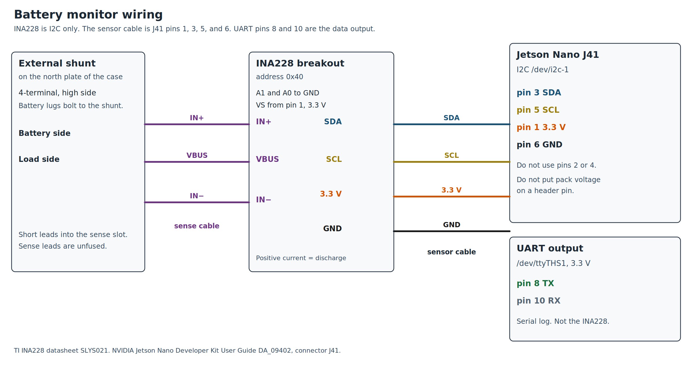
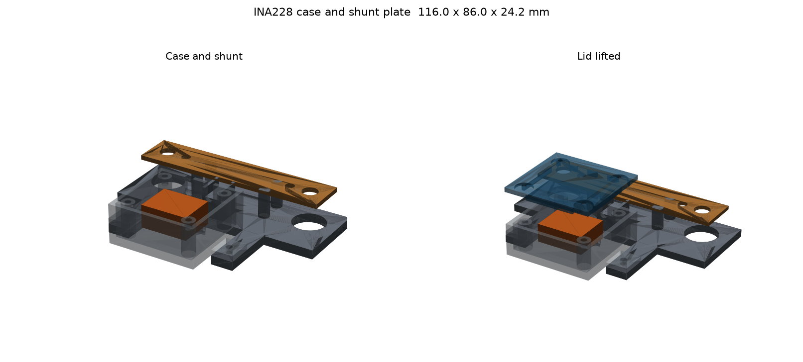

# Jetson Nano 배터리 모니터

[English](README.md) | [한국어](README.ko.md)

이 모니터는 배터리 팩 하나를 읽는다. 팩 전류는 외부 션트가 흘린다. Jetson Nano I2C 헤더의 INA228이 그 션트를 읽는다. 서비스는 쿨롱을 적산하고, 충전 상태를 추정하고, JSON 파일을 쓰고, 같은 값을 UART로 출력한다. 화면은 Jetson에서 이미 돌고 있는 웹 앱이다. 이 폴더에는 웹 서버가 없다.

팩의 화학, 전압, 용량, 전류는 모른다. 그 칸은 [`software/config/battery_profile.json`](software/config/battery_profile.json)에서 null이다. 팩 데이터시트로 채우기 전에는 실제 센서를 열지 않는다. [`bom/BOM.csv`](bom/BOM.csv)의 션트 행은 그때까지 BLOCKED다. 예시 파일의 숫자는 권장 팩이 아니다.

이 장치는 배터리 관리 장치가 아니다. 셀 밸런스를 하지 않고 접촉기를 열지 않는다.

## 연결

| 부품 | 역할 |
|---|---|
| 4단자 션트 | 배터리 양극 리드에 둔다. 이 상자 밖이다. 팩 전류는 INA228 기판으로 들어오지 않는다. |
| INA228 브레이크아웃 | 전압과 양방향 전류. A1과 A0를 GND에 두면 주소는 0x40. VS는 Jetson 핀 1. |
| Jetson Nano | `/dev/i2c-1`을 읽고, 상태 파일과 `/dev/ttyTHS1`을 쓴다. |

INA228 버스 범위는 0 V에서 85 V다 (TI SLYS021). 팩이 85 V를 넘을 수 있으면 연결하지 않는다. 프로필 로더가 그 경우를 거절한다. 기본 범위에서 션트는 R < 163.84 mV / Imax 를 만족해야 한다 (SLYS021 식 8). 저항값은 여기서 고르지 않는다.

양전류는 방전, 배터리에서 나가는 방향이다. 음전류는 충전이다. 전력도 같은 부호다.

VBUS는 팩 단자 전압이다. 션트의 배터리 쪽에서 따고, 켈빈 핀에서 따지 않는다. IN+는 션트의 배터리 쪽, IN−는 부하 쪽이다.



INA228은 I2C 전용이다. UART 핀이 없다.

INA228에서 Jetson으로 가는 선은 센서 케이블이다. J41 핀 1(3.3 V), 핀 6(GND), 핀 3(SDA), 핀 5(SCL). 이 핀이 `/dev/i2c-1`이다. 신호는 3.3 V다 (NVIDIA Jetson Nano Developer Kit User Guide, DA_09402). 헤더 핀에 팩 전압을 넣지 않는다. 헤더 핀 2와 4에 전원을 넣지 않는다.

UART 핀 8(TX)과 핀 10(RX)은 `/dev/ttyTHS1`이다. 이 포트는 직렬 데이터 출력이다. INA228을 연결하는 선이 아니다.

감지 선과 VBUS 선에는 퓨즈가 없다. 이 선이 단락되면 단락 사고의 위험이 있고, 소유자가 그 위험을 받아들였다.

## Jetson 웹 앱이 값을 읽는 방법

화면은 Jetson Nano에서 이미 실행 중인 웹 앱이다. 이 서비스는 페이지를 제공하지 않는다. 앱이 INA228을 직접 열지 않는다.

앱은 파일 하나를 읽는다.

`/var/lib/battery-monitor/state.json`

[`software/systemd/battery-monitor.service`](software/systemd/battery-monitor.service)의 경로다. `software/`에서 직접 실행하면 `--state`를 주지 않는 한 `run/state.json`에 쓴다. 파일은 원자적으로 바뀐다. 임시 파일에 쓰고, fsync하고, 이름을 바꾼다. 배포 프로필은 샘플마다 다시 쓴다 (`persist_interval_s` 0.5). `SIGTERM`이면 종료 전에 한 번 더 쓴다.

| 필드 | 의미 |
|---|---|
| `updated_unix` | 이 파일을 만든 샘플의 유닉스 초. |
| `voltage_v` | VBUS에서 본 팩 전압. 마지막 읽기가 실패하면 null. |
| `current_a` | 부호 있는 암페어. 양수는 방전. |
| `power_w` | `voltage_v * current_a`. 양수 전력은 배터리에서 나간다. |
| `soc_percent` | 충전 상태. 0–100으로 자른다. 기준점이 없으면 null. |
| `soc_unclamped_percent` | 자르지 않은 같은 값. |
| `capacity_ah` | 남은 암페어시. |
| `nominal_capacity_ah` | 프로필의 용량. |
| `energy_wh` | 적산한 와트시. 충전하면 감소한다. |
| `ampere_hours_out` | 적산한 암페어시. 재시작에 쓰는 카운터. |
| `watt_hours_out` | `energy_wh`와 같은 값. 적산을 이어 가기 위해 남긴다. |
| `soc_anchor_percent`, `ah_at_anchor` | 쿨롱 카운트 기준. 앱은 무시해도 된다. |
| `status` | `Charging`, `Discharging`, `Idle`, `Fault`. |
| `runtime_hours`, `runtime_label` | 방전 중 남은 시간, 또는 충전 중 가득 찰 때까지의 시간. `runtime_label`은 `remaining` 또는 `time_to_full`. |
| `faults` | 알람 이름 목록. 프로필 한계 안이면 빈 목록. |
| `comms_ok` | INA228 읽기에 실패하면 false. |
| `stale` | `comms_ok`가 false이면 true. |
| `simulated` | 시뮬레이션 센서이면 true. |
| `power_loss_gap` | 재시작이나 긴 공백 뒤에 true. 그 시간은 적산하지 않는다. |
| `ocv_corrected` | 휴지 개방 전압 보정을 적용한 샘플이면 true. |
| `profile_name`, `chemistry` | 프로필에서 복사한다. |

`comms_ok`가 false이면 `voltage_v`와 `current_a`는 null이다. 파일이 얼마나 오래됐는지는 `updated_unix`로 본다.

옆의 SQLite 파일(`/var/lib/battery-monitor/history.sqlite`)은 기록이다. 실시간 값은 JSON 파일이다.

같은 행을 `/dev/ttyTHS1`, 115200 baud, 3.3 V로 샘플마다 CSV 한 줄 출력한다.

```text
unix_s,voltage_v,current_a,power_w,soc_percent,capacity_ah,energy_wh,status,faults
```

그 줄의 `capacity_ah`는 남은 암페어시다. `faults`는 `|`로 잇는다.

## 상자

인쇄 상자는 INA228 기판만 넣는다. 몸체 **48.8 × 46.4 × 20.1 mm**. 양쪽 플랜지를 넣으면 **72.8 × 46.4 × 20.1 mm**. 안쪽 **43.8 × 41.4 × 15.1 mm**. 벽, 바닥, 뚜껑은 2.5 mm. 끼워맞춤은 면마다 0.25 mm. 이 상자 형상은 그대로다.

별도 판이 기존 플랜지 구멍 두 개에 체결되고, 북쪽 벽의 감지 슬롯 옆으로 나간다. 션트는 그 판의 스탠드오프 위에 있다. 판의 경계 상자는 **116.0 × 69.8 × 18.05 mm**다. 상자와 판을 합치면 **116.0 × 86.0 × 24.15 mm**다. 배터리 러그는 션트에 체결한다. 감지 나사에서 감지 슬롯까지 짧은 홈이 있다.

외곽은 Accuenergy Shunt-100A, 75 mV다. 104 × 21.6 × 2.0 mm, Φ8.5 구멍 피치 85 mm, M5 감지 나사 피치 62 mm ([데이터시트](https://www.accuenergy.com/wp-content/uploads/DC-Current-Shunt-100A-75mV.pdf), 2024년 8월). 팩 전류는 아직 모르므로 이것은 기계 외곽이지 고른 정격이 아니다. 피치, 구멍, 외곽은 `enclosure.py`의 매개변수다.

북쪽 벽의 열린 슬롯은 두 개다. 센서 케이블, 그리고 감지 케이블(IN+, IN−, VBUS). Jetson은 상자 밖에 있다. 감지 선과 VBUS 선에는 퓨즈가 없다.



`battery/enclosure`에서 `python3 enclosure.py`로 다시 만든다. 자세한 내용은 [`enclosure/README.md`](enclosure/README.md)에 있다.

## 소프트웨어

실행과 테스트: [`software/README.ko.md`](software/README.ko.md). 부품: [`bom/BOM.csv`](bom/BOM.csv).
