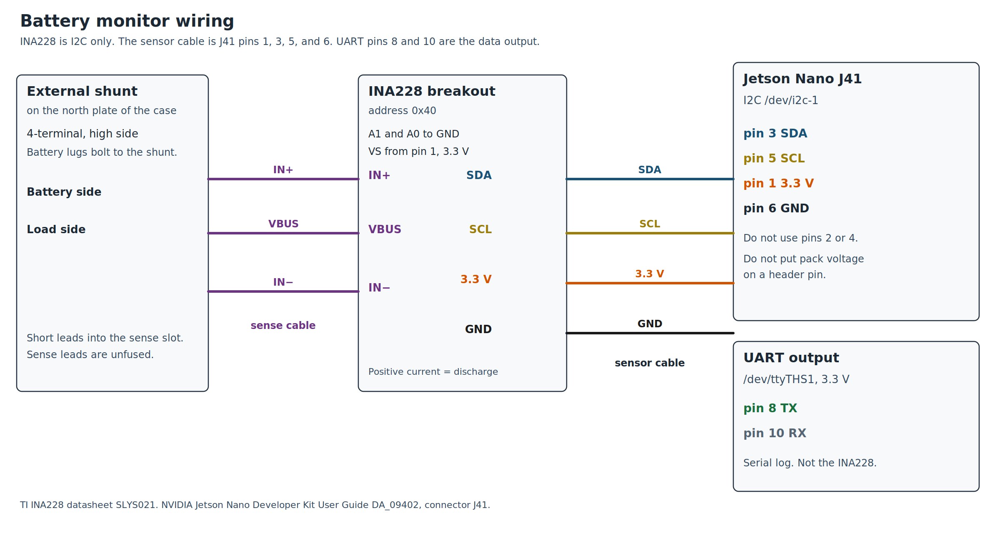
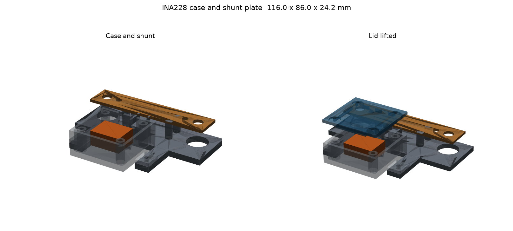

# Jetson Nano battery monitor

[English](README.md) | [한국어](README.ko.md)

This monitor reads one battery pack. An external shunt carries the pack current. An INA228 on the Jetson Nano I2C header reads that shunt. The service counts coulombs, estimates state of charge, writes a JSON file, and prints the same readings on the UART. The web app that already runs on the Jetson is the display. This folder does not contain a web server.

The pack chemistry, voltages, capacity, and currents are not known. Those fields are null in [`software/config/battery_profile.json`](software/config/battery_profile.json). The program will not open the real sensor until they are filled in from the pack datasheet. The shunt row in [`bom/BOM.csv`](bom/BOM.csv) stays BLOCKED until then. Nothing in the example file is a suggested pack.

This is not a battery management system. It does not balance cells and it does not open a contactor.

## What is connected

| Part | Role |
|---|---|
| 4-terminal shunt | In the battery positive lead, outside this case. Pack current does not enter the INA228 board. |
| INA228 breakout | Voltage and bidirectional current. Address 0x40 with A1 and A0 at ground. VS from Jetson pin 1. |
| Jetson Nano | Reads `/dev/i2c-1` and writes the state file and `/dev/ttyTHS1`. |

The INA228 bus range is 0 V to 85 V (TI SLYS021). If the pack can exceed 85 V, do not connect it. The profile loader rejects that case. The shunt must satisfy R < 163.84 mV / Imax on the default range (SLYS021 equation 8). The resistance is not chosen here.

Positive current is discharge, out of the battery. Negative current is charge. Power uses the same sign.

VBUS is the pack terminal voltage, taken from the battery side of the shunt, not from the Kelvin pin. IN+ is the battery side of the shunt. IN− is the load side.



The INA228 is I2C only. It has no UART pins.

The cable from the INA228 to the Jetson is the sensor cable: J41 pin 1 (3.3 V), pin 6 (GND), pin 3 (SDA), pin 5 (SCL). Those pins are `/dev/i2c-1`. Signals are 3.3 V (NVIDIA Jetson Nano Developer Kit User Guide, DA_09402). Do not put pack voltage on a header pin. Do not power header pins 2 and 4.

UART pins 8 (TX) and 10 (RX) are `/dev/ttyTHS1`. That port is the serial data output. It is not the connection to the INA228.

The sense and VBUS leads are unfused. A short on those leads is a short-circuit risk, and the owner accepted it.

## How the Jetson web app reads the data

The display is the web app that already runs on the Jetson Nano. This service does not serve a page, and the app should not open the INA228 itself.

The app reads one file:

`/var/lib/battery-monitor/state.json`

That is the path in [`software/systemd/battery-monitor.service`](software/systemd/battery-monitor.service). A hand run from `software/` writes `run/state.json` unless you pass `--state`. The file is replaced atomically (write a temp file, fsync, rename). The shipped profile rewrites it every sample (`persist_interval_s` 0.5). `SIGTERM` writes it once more before exit.

| Field | Meaning |
|---|---|
| `updated_unix` | Seconds since the epoch, from the sample that produced this file. |
| `voltage_v` | Pack voltage at VBUS. Null when the last read failed. |
| `current_a` | Signed amperes. Positive is discharge. |
| `power_w` | `voltage_v * current_a`. Positive power leaves the battery. |
| `soc_percent` | State of charge, clamped to 0–100. Null until an anchor exists. |
| `soc_unclamped_percent` | Same count without the clamp. |
| `capacity_ah` | Remaining ampere-hours. |
| `nominal_capacity_ah` | Capacity from the profile. |
| `energy_wh` | Accumulated watt-hours out. Charge makes this fall. |
| `ampere_hours_out` | Accumulated ampere-hours out. This is the resume counter. |
| `watt_hours_out` | Same quantity as `energy_wh`. Kept so a restart can continue the integral. |
| `soc_anchor_percent`, `ah_at_anchor` | Coulomb-count anchor. The app can ignore these. |
| `status` | `Charging`, `Discharging`, `Idle`, or `Fault`. |
| `runtime_hours`, `runtime_label` | Remaining time while discharging, or time to full while charging. `runtime_label` is `remaining` or `time_to_full`. |
| `faults` | List of alarm names. Empty when the sample is inside the profile limits. |
| `comms_ok` | False when the INA228 read failed. |
| `stale` | True when `comms_ok` is false. |
| `simulated` | True when the process is on the simulated sensor. |
| `power_loss_gap` | True after a restart or a long gap. The downtime was not integrated. |
| `ocv_corrected` | True on the sample that applied a rest open-circuit correction. |
| `profile_name`, `chemistry` | Copied from the profile. |

If `comms_ok` is false, `voltage_v` and `current_a` are null. Use `updated_unix` to see how old the file is.

A SQLite history file is written beside it (`/var/lib/battery-monitor/history.sqlite`). That file is a log. The live reading is the JSON file.

The same row is printed on `/dev/ttyTHS1` at 115200 baud, 3.3 V, one CSV line per sample:

```text
unix_s,voltage_v,current_a,power_w,soc_percent,capacity_ah,energy_wh,status,faults
```

`capacity_ah` on that line is the remaining ampere-hours. `faults` are joined with `|`.

## Case

The printed case holds only the INA228 board. Body **48.8 × 46.4 × 20.1 mm**. With the two side flanges, **72.8 × 46.4 × 20.1 mm**. Cavity **43.8 × 41.4 × 15.1 mm**. Wall, floor, and lid are 2.5 mm. Fit clearance is 0.25 mm per side. That case is unchanged.

A separate plate bolts to the two existing flange holes and extends off the north wall, beside the sense slot. The shunt sits on standoffs on that plate. The plate’s own bounding box is **116.0 × 69.8 × 18.05 mm**. Case plus plate is **116.0 × 86.0 × 24.15 mm**. Battery lugs bolt to the shunt. A short channel runs from the sense screws to the sense slot.

The footprint is the Accuenergy Shunt-100A, 75 mV: 104 × 21.6 × 2.0 mm, Φ8.5 holes on an 85 mm pitch, M5 sense screws on a 62 mm pitch ([datasheet](https://www.accuenergy.com/wp-content/uploads/DC-Current-Shunt-100A-75mV.pdf), August 2024). The pack current is still unknown, so this is a mechanical outline, not a chosen shunt rating. Pitch, hole size, and the outline are parameters in `enclosure.py`.

The north wall has two open slots: the sensor cable, and the sense cable (IN+, IN−, VBUS). The Jetson is not in the box. The sense and VBUS leads are unfused.



Regenerate with `python3 enclosure.py` from `battery/enclosure`. Details are in [`enclosure/README.md`](enclosure/README.md).

## Software

Run and test notes: [`software/README.md`](software/README.md). Parts: [`bom/BOM.csv`](bom/BOM.csv).
