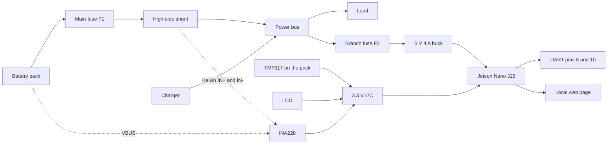
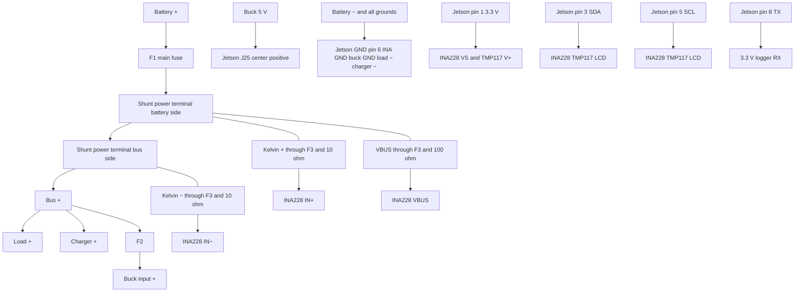

# Jetson Nano battery charge and discharge monitor

[English](README.md) | [한국어](README.ko.md)

A local monitor for one battery pack: voltage, bidirectional current, signed power, accumulated ampere-hours and watt-hours, state of charge, charge/discharge/idle, pack temperature, and remaining time. The controller is an **NVIDIA Jetson Nano** (the developer kit with the 5 V barrel jack). It is not an ESP32 and it is not the Jetson Orin Nano used on the robot. The Orin Nano is powered from a higher-voltage barrel; do not reuse the 5 V power section on it.

The pack chemistry, voltages, capacity, and currents are **not known**. Those fields are null in [`software/config/battery_profile.json`](software/config/battery_profile.json). The program will not open a real sensor until they are filled in from the pack datasheet. The parts that depend on them are marked BLOCKED in [`bom/BOM.csv`](bom/BOM.csv). Nothing in the example files is a suggested pack.

This monitor is not a battery management system. It does not balance cells and it does not open a contactor. Overcurrent protection is the fuse.

## 1. Recommended architecture

Measure net pack current with a **4-terminal shunt in the battery positive lead**, read by a **TI INA228**. The INA228 was chosen because the pack voltage is unknown and its bus range is 0 V to 85 V. An INA226 stops at 36 V, so picking it would be a guess that the pack never exceeds 36 V. The INA228 still cannot be used if the highest voltage on the sense node is above 85 V. That check is mandatory and is enforced by the profile loader.

The Jetson does not sit on the pack rail. A separate buck, fused on the load side of the shunt, makes 5 V at 4 A for the developer-kit barrel jack. Pack voltage never lands on a Jetson pin. The INA228 common-mode range is what allows the shunt to sit up at pack voltage while the chip itself runs from the Jetson 3.3 V pin.

Pack temperature is a **TMP117** on the pack, on the same 3.3 V I2C bus. The INA228 die temperature is the temperature of the chip, not the cells. A 20×4 I2C LCD and a local web page on the Jetson both show the same readings. UART on the 40-pin header prints the same row for an external logger. There is no cloud service.



### Sensor comparison

| Approach | Part | Range | Bidirectional | Accuracy, from the datasheet | Interface | Extra parts | Isolation | Decision |
|---|---|---|---|---|---|---|---|---|
| Hall | Allegro ACS712 | ±5 A, ±20 A, or ±30 A versions; 5.0 V supply | Yes. The datasheet covers uni- or bi-directional current | Total output error 1.5% at 25 °C for the ±5 A version at ±5 A | Analog voltage | An ADC. The Jetson 40-pin header has none. Also a 5 V supply | 2.4 kVRMS, pins 1–4 to pins 5–8 | Not used. Analog output, fixed range, 5 V |
| Shunt monitor | TI INA226 | Bus 0 V to 36 V. Do not apply more than 36 V. Shunt ±81.92 mV | Yes, high-side or low-side | Gain error 0.1% max, shunt offset 10 µV max. 16-bit | I2C, supply 2.7 V to 5.5 V | External shunt | None | Not used. 36 V may be below this pack |
| Shunt monitor | TI INA228 | Common mode −0.3 V to +85 V. Bus 0 V to 85 V. Shunt ±163.84 mV or ±40.96 mV | Yes, high-side or low-side | Shunt offset ±1 µV max, gain error ±0.05% max. 20-bit | I2C, supply 2.7 V to 5.5 V | External shunt | None | **Used**, if and only if the pack stays at or below 85 V |
| Coulomb counter | ADI LTC2944 | Supply 3.6 V to 60 V. Sense ±50 mV for the stated accuracy | Yes | Total charge error ±1% at 25 °C for a 10 mV to 50 mV sense voltage, ±1.5% over temperature | I2C | External shunt | None | Not used. Stops at 60 V |
| Fuel gauge | TI bq34z100-G1 class | Depends on an external divider and a programmed chemistry | Yes, with an external shunt | Not quoted here. The part is a programmed gauge, not a raw register read | I2C after chemistry programming | Shunt, divider, a chemistry image | None | Not used. More procedure than this monitor needs, and the chemistry is unknown |
| Discrete shunt and ADC | — | Set by the divider and the ADC | Only if the ADC accepts both signs | Set by the ADC and the shunt | SPI or analog | ADC, reference, divider | None | Not used. The header has no ADC, so this adds more parts than an INA228 |

Datasheets: [INA228 SLYS021](https://www.ti.com/lit/ds/symlink/ina228.pdf), [INA226](https://www.ti.com/lit/ds/symlink/ina226.pdf), [ACS712](https://www.allegromicro.com/-/media/Files/Datasheets/ACS712-Datasheet.pdf), [LTC2944](https://www.analog.com/media/en/technical-documentation/data-sheets/2944fa.pdf), [TMP117](https://www.ti.com/lit/ds/symlink/tmp117.pdf). Jetson header and power: [Jetson Nano Developer Kit User Guide](https://developer.nvidia.com/embedded/dlc/jetson-nano-developer-kit-user-guide).

## 2. How bidirectional measurement works

The shunt is a 4-terminal resistor. Pack current flows through the heavy terminals. The INA228 IN+ and IN− pins connect only to the Kelvin sense terminals, so copper on the power lugs is not part of the measured resistance. TI's layout section requires this connection.

IN+ goes to the **battery** side of the shunt. IN− goes to the **bus** side (load and charger). The INA228 converts IN+ − IN−. Positive shunt voltage is current leaving the battery, which this software calls **discharge**. Negative shunt voltage is current into the battery, **charge**. If the sense wires are swapped, set `invert_current` in the profile rather than changing the math.

One shunt measures **net** battery current:

`I_battery = I_load − I_charger`

The charger must land on the bus, on the load side of the shunt. Charge current then flows back through the shunt into the pack and is counted. A charger landed on the battery side of the shunt is invisible. While both the charger and the load are active, the status follows the sign of the net current. The ampere-hour and watt-hour totals are still the pack totals, which is what a single fuel account needs. Separate charge current and load current would need a second shunt. That second shunt is not fitted.

The INA228 POWER register is unsigned. Signed power is computed in software as `V_bus × I_signed`. The on-chip ENERGY and CHARGE registers reset when the INA228 supply drops and they roll over, so they are not the stored record. The Jetson integrates current and power and stores the totals.

Idle, charge, and discharge come from a threshold `idle_current_a` that you set above the noise and below the smallest current you care about:

- `I > idle` → Discharging
- `I < −idle` → Charging
- otherwise → Idle

### High-side, not low-side

The shunt stays in the positive lead.

A low-side shunt sits in the return. Every load and the charger must return through it or their current is missed, and any extra ground path bypasses it. It also lifts the load ground by `I × R` relative to the pack negative. The Jetson ground, the buck ground, and the charger ground would then disagree by that drop.

A high-side shunt leaves the pack negative as the one ground for the Jetson, the buck, the charger, and the load. The INA228 is specified for that placement: common mode up to 85 V while the chip supply is 2.7 V to 5.5 V, and the datasheet states that the bus may be present with the chip supply off. A short from the bus to ground still passes through the shunt.

## 3. Components

Electrical numbers below are from the cited datasheets, not from a module listing.

### INA228 (TI SLYS021)

| Item | Value |
|---|---|
| Supply VS | 2.7 V to 5.5 V. This design uses Jetson 3.3 V |
| Quiescent current | 640 µA typical, 750 µA max at 25 °C, VSENSE = 0 |
| Common mode | −0.3 V to +85 V |
| Bus voltage | 0 V to 85 V, LSB 195.3125 µV |
| Shunt range | ±163.84 mV (ADCRANGE = 0) or ±40.96 mV (ADCRANGE = 1) |
| Shunt LSB | 312.5 nV or 78.125 nV |
| Offset | ±1 µV max on the shunt |
| Gain error | ±0.05% max, shunt and bus |
| Input bias | 0.1 nA typical, 2.5 nA max at 85 V, either IN pin |
| Differential impedance | 92 kΩ typical |
| VBUS impedance | 0.8 MΩ min, 1 MΩ typical, 1.2 MΩ max, active |
| Die temperature | ±1 °C max at 25 °C, ±2 °C max from −40 °C to 125 °C. This is not pack temperature |
| Logic high | 1.2 V to 5.5 V, so a 3.3 V bus is valid |
| Absolute maximum | VS 6 V, IN common mode 85 V, SDA/SCL 6 V, current into any pin 5 mA |
| Identity | Manufacturer 0x5449, device 0x2281 |
| Address | 0x40 with A1 and A0 at GND. The breakout default used here |

Use a breakout that brings out IN+, IN−, and VBUS, for example the [Adafruit INA228](https://learn.adafruit.com/adafruit-ina228-i2c-power-monitor). That guide shows the header pins and 10 kΩ pull-ups to VIN, and it shows high-side wiring to an external shunt. Power VIN from Jetson pin 1 (3.3 V). If VIN is 5 V, those 10 kΩ resistors pull the Jetson I2C pins up toward 5 V. Do not do that. Pack current does not flow through the breakout.

The design uses ADCRANGE = 0 (±163.84 mV) unless the profile sets `adc_range_mv` to 40.96. Averaging is 128 and the conversion time is 1052 µs on bus, shunt, and die temperature. Three conversions at that setting are about 404 ms between register updates.

### Shunt

Not selected. Resistance, current rating, and power rating come from the pack current and from the shunt datasheet.

`R_shunt < 0.16384 V / I_max`

`I_max` is the larger of the maximum charge current and the maximum discharge current. The loader rejects a profile where `I_max × R` exceeds full scale, and it warns above 90% of full scale. Dissipation is `I² × R` and must stay inside the shunt's own continuous rating. Put the shunt where its heat can leave. The sense terminals, not the power terminals, go to the INA228.

### TMP117 (TI SNOSD82)

| Item | Value |
|---|---|
| Accuracy | ±0.1 °C max from −20 °C to 50 °C, no calibration |
| Resolution | 0.0078125 °C (1/128 °C) |
| Supply | 1.8 V to 5.5 V over the full temperature range. Use 3.3 V |
| I2C | Up to 400 kHz. Address 0x48 with ADD0 at GND |
| Input high | 0.7 × V+. At 3.3 V that is 2.31 V |
| Pins | Recommended I/O voltage up to 5.5 V. The Jetson side of the bus is still 3.3 V |
| Device ID | Register 0x0F reads 0x0117 |

Mount it on the pack, not on the INA228 board. An Adafruit TMP117 breakout (product 4821) is a suitable carrier; the limits above are the TI limits.

### LCD

A 20×4 HD44780-style module with a PCF8574 backpack. The driver assumes the common backpack map: P0 RS, P1 RW, P2 E, P3 backlight, P4–P7 data. Confirm the module's address, usually 0x27 or 0x3F, and set `lcd_address`. The LCD lines use short codes (CHG, DIS, IDLE, FAULT) because the module is 20 columns. The web page uses the full words.

Whether this module needs a level shifter is in section 4. Confirm the module's Vdd from its own datasheet before choosing 3.3 V or 5 V.

### Jetson Nano

From the developer-kit user guide (the kit whose barrel is J25, not the 2GB kit and not an Orin):

| Item | Value |
|---|---|
| Barrel J25 | 5 V, 4 A supply when the load needs it. Center positive, 2.1 mm × 5.5 mm, 9.5 mm plug. The guide's maximum supported continuous current on this jack is 4.4 A |
| J48 | Fit the jumper so the barrel is the source and Micro-USB is not |
| Module input | Keep at least 4.75 V at the connector |
| Header | J41, 40 pin. Signal pins are 3.3 V |
| I2C | Pins 3 and 5 are I2C1, the usual `/dev/i2c-1`. Pins 27 and 28 are I2C0, shared with the camera |
| UART | Pins 8 and 10 are `/dev/ttyTHS1` |
| Do not | Power the kit from J25 and from the header 5 V pins at the same time |

I2C header pins on these carriers are pulled up to 3.3 V with 2.2 kΩ and go to the module. They are not routed through the TXB0108. UART and the other non-I2C signals are. The TXB0108 outputs are weak (the carrier pin notes give about 20 µA). A short 3.3 V UART cable is fine. Do not hang a low-value pull-up on those pins.

### USB-I2C adapter

The header bus is the default and needs no adapter. A USB adapter is the alternative when pins 3 and 5 are already used.

An adapter that speaks the **i2c-tiny-usb** protocol is bound by the Linux `i2c-tiny-usb` driver and shows up as `/dev/i2c-N`. `N` is chosen by the kernel and can change if you replug the device. Set `i2c_bus` to that path. Confirm the binding with `i2cdetect -l`.

The driver has been in the kernel for a long time. The Nano's stock JetPack 4.6 kernel is 4.9, and NVIDIA's config may not enable `CONFIG_I2C_TINY_USB`. Check `zcat /proc/config.gz | grep I2C_TINY_USB`. If the option is absent, use `/dev/i2c-1` on the header.

The adapter's I2C side must be 3.3 V if it shares a bus with the TMP117 and the INA228. It must not be connected at the same time as the header. Two masters, or a 5 V pull-up on the Jetson pins, is a wiring error. The software change between the two masters is only the `i2c_bus` string.

### Buck, fuses, enclosure

The buck is BLOCKED. It must deliver 5.0 V to 5.25 V at 4 A continuous, and its input range must include the pack from the empty cutoff through the highest voltage the charger can put on the bus. Those voltages are unknown, so no part number is listed. NVIDIA's validated GEO241DA-0540 supply is an AC adapter that meets the barrel contract; it is not a battery buck and it is not part of this build.

Fuses and wire gauge are in the safety section. The printed enclosure is in [section 11](#11-enclosure). The shunt stays outside it.

## 4. Connection and measurement

### Wiring


This picture is the wiring reference. Colors on it are suggested. Each line is one connection. The bottom band groups the three cables that enter the display pod. Edit it with `wiring/draw_wiring.py`. The chart below is the same path in short form.



VBUS is taken on the battery side of the shunt so the voltage used for state of charge is the pack terminal voltage. The difference from the bus side is the shunt drop, under 164 mV.

### Pin and connection table

| Function | Jetson Nano J41 | Other end | Level |
|---|---|---|---|
| 3.3 V | Pin 1 | INA228 VIN, TMP117 V+, LCD if the LCD is 3.3 V | 3.3 V. Do not power the Jetson from this pin |
| I2C1 SDA | Pin 3, `/dev/i2c-1` | INA228 SDA, TMP117 SDA, LCD SDA | 3.3 V open drain |
| I2C1 SCL | Pin 5 | INA228 SCL, TMP117 SCL, LCD SCL | 3.3 V open drain |
| Ground | Pin 6 | INA228 GND, sensor GND, UART GND, buck ground, battery negative | Common ground. Not isolated |
| UART TX | Pin 8, `/dev/ttyTHS1` | External 3.3 V RX | 3.3 V, weak driver |
| UART RX | Pin 10 | External 3.3 V TX, optional | 3.3 V |
| Ground | Pin 9 | UART ground if pin 6 is used elsewhere | |
| I2C0 | Pins 27 and 28, usually `/dev/i2c-0` | Do not use if a camera is fitted | Alternate header bus only |
| 5 V in | J25 barrel, J48 fitted | Buck output, center positive | 5 V, 4 A capable |
| Header 5 V | Pins 2 and 4 | Not used as the Jetson supply | Do not also power J25 |
| USB | J32 or J33 | i2c-tiny-usb adapter, only if the header bus is not used | Adapter I2C side at 3.3 V |
| Shunt Kelvin + | — | INA228 IN+, battery side, via F3 and 10 Ω | Pack voltage |
| Shunt Kelvin − | — | INA228 IN−, bus side, via F3 and 10 Ω | Pack voltage |
| VBUS | — | INA228 VBUS from the battery side, via F3 and 100 Ω | 0 V to 85 V |

### I2C level shifters

No level shifter on the INA228 or the TMP117.

Both chips accept a 3.3 V high when they are powered from 3.3 V. The INA228 logic-high minimum is 1.2 V. The TMP117 logic-high minimum is 0.7 × V+. The carrier already pulls SDA and SCL to 3.3 V with 2.2 kΩ. The Adafruit INA228 adds 10 kΩ to its VIN. With VIN at 3.3 V the parallel combination is about 1.8 kΩ, which is a normal fast-mode pull-up. A shifter here would be an extra part with no job.

A 5 V LCD backpack is the case that needs a shifter. Its pull-ups sit at 5 V, and the Jetson I2C pins are not a 5 V bus. Either:

- power the backpack from pin 1, if the module's datasheet allows that Vdd and the contrast is acceptable, and leave the shifter out, or
- power the backpack from 5 V and put a BSS138 bidirectional shifter between the backpack and the Jetson, as in NXP AN10441. The low side is 3.3 V. The high side is 5 V. The INA228 and the TMP117 stay on the 3.3 V side.

Do not solve a 5 V LCD by pulling the whole bus up to 5 V.

### What the software measures

Each sample, the driver checks manufacturer 0x5449 and device 0x2281, writes `SHUNT_CAL` from the profile's current limit and shunt resistance, and reads VBUS, CURRENT, and the diagnostic register. The TMP117 temperature register is read on the same bus. Calibration gains and offsets from the profile are applied after the raw conversion. The integral uses that calibrated current. A failed I2C transaction sets the COMMS fault and **does not** add ampere-hours for that step.

The I2C bus path is `i2c_bus` in the profile. `/dev/i2c-1` is the header default.

## 5. Design problems and solutions

| Problem | What was done |
|---|---|
| Pack voltage is unknown | INA228, 85 V full scale. The loader refuses `max_voltage_v` above 85. The buck, main fuse, and wire gauge stay BLOCKED |
| Pack current is unknown | Shunt resistance is a profile field. The limit is `0.16384 / I_max`. No resistance is recommended |
| A unidirectional sensor would hide charge | IN+ / IN− polarity. Negative current is charge. Tests cover both signs |
| Charge and load at the same time | One high-side shunt reads the net pack current, which is the correct fuel-gauge input. It does not split the two currents |
| INA228 power register has no sign | Software power is `V × I` with the signed current |
| Chip energy and charge reset on power loss | Software integral in an atomic JSON file. The off interval is not filled in |
| A long stall would invent ampere-hours | If the step is longer than `max_integrate_dt_s` (default 5 s), that step is displayed and not integrated |
| Coulomb count drifts | At rest, if you supplied an OCV table for this chemistry, SOC is set from that table once per rest. No table means no voltage-to-SOC guess |
| Jetson header has no ADC | Rejected the analog Hall sensor. I2C only |
| 5 V versus 3.3 V | Sensors at 3.3 V. Shifter only for a 5 V LCD |
| Header I2C may already be in use | Optional i2c-tiny-usb adapter, configured by path, never paralleled with the header |
| UART driver is weak | Log only, short 3.3 V cable, no extra pull-up |
| Flash wear | State JSON is rewritten on `persist_interval_s` (default 30 s) and on shutdown, not every sample. History is an append to SQLite on its own interval |
| This is not a protection circuit | Fuses do the disconnect. Software faults are alarms on the LCD, UART, and web page |

## 6. Safety

The sensor is not isolation. Battery negative, Jetson ground, INA228 ground, buck ground, charger negative, and load negative are one node. A wiring error can put pack voltage on that node or on a sense wire. Hall isolation, as on the ACS712, is not provided by this circuit.

### Power path and electronics path

Pack current stays in the cable, the main fuse, the shunt element, and the bus. The Jetson is fed only by the buck's 5 V output into J25. The INA228 sees pack voltage only on IN+, IN−, and VBUS, which are rated for it, and sees 3.3 V on VS and on the I2C pins.

Never land a pack conductor on a Jetson header pin. Never power J25 and header pins 2/4 together.

### Fuses

| Fuse | Where | Rating |
|---|---|---|
| F1 | Battery positive, before the shunt, as close to the cell as practical | At or below the wire ampacity, and within the pack manufacturer's limit. Current is unknown, so this fuse is BLOCKED. Voltage rating must exceed the highest bus voltage |
| F2 | Load side of the shunt, in the buck's input lead | Above the buck's input current at the lowest pack voltage, and below that branch's wire ampacity. BLOCKED until the buck and the pack voltage exist |
| F3 | Three signal fuses: IN+ Kelvin, IN− Kelvin, VBUS, at the shunt end of each wire | 100 mA, because the normal current in these wires is the INA228 bias (2.5 nA max), not pack current. Voltage rating must exceed the pack voltage and is BLOCKED |

### Kelvin resistors

10 Ω in each sense lead, next to the INA228, and 100 Ω in the VBUS lead.

The typical differential impedance is 92 kΩ. Two 10 Ω resistors give a gain of `92000 / (92000 + 20)`, about 0.99978. That is a 0.022% error before calibration. The 92 kΩ figure is typical, not a limit, so the software does not "correct" it with this formula. Calibration measures the real gain.

VBUS impedance is at least 0.8 MΩ. A 100 Ω series resistor is a 0.0125% divider against that minimum.

These resistors do **not** hold a short from a sense wire to ground inside the 5 mA absolute-maximum pin current. At an unknown pack voltage, `V / 10 Ω` is far above 5 mA. F3 is what opens that fault. The resistor is there so a small, matched series element sits at the chip, and so the gain error stays inside what calibration removes.

### Wire gauge

Use the pack current, once you know it, and the code that applies to the installation. As a conservative check, copper ampacity in the 60 °C column of NEC Table 310.16 (NFPA 70) is:

| AWG | 60 °C copper |
|---|---|
| 14 | 15 A |
| 12 | 20 A |
| 10 | 30 A |
| 8 | 40 A |
| 6 | 55 A |
| 4 | 70 A |
| 3 | 85 A |
| 2 | 95 A |
| 1 | 110 A |
| 1/0 | 125 A |
| 2/0 | 145 A |
| 3/0 | 165 A |
| 4/0 | 195 A |

The table does not list wires smaller than 14 AWG. The Jetson barrel circuit is 4 A, so 14 AWG meets this column with margin. The main pack conductor is not chosen here. F1 must be at or below the ampacity of the wire you actually fit. Sense leads are 22 or 24 AWG twisted pair because their current is nanoamps; F3 protects them, not the ampacity table.

### Reverse polarity

Do not put a series diode in the main pack lead. The lead has to carry charge in one direction and discharge in the other, and a diode at these currents is a heater.

The INA228 common-mode absolute maximum is −0.3 V. A reversed pack takes IN+, IN−, and VBUS outside that limit and can destroy the chip. The 10 Ω resistors do not make reverse connection safe. Do not connect the pack backwards.

When the buck is selected, its input needs its own reverse-protection device rated for the pack voltage and for the buck input current. That part is BLOCKED with the buck. The barrel jack is center positive.

### Overcurrent and voltage

F1 is the disconnect. Software compares the reading with `max_discharge_current_a`, `max_charge_current_a`, `max_voltage_v`, and `min_voltage_v` and raises an alarm. It does not clear the fault by itself and it does not switch the pack. If the shunt voltage reaches the ADC full scale, the reading is clipped and the fault `SHUNT_SATURATED` is raised; do not treat a clipped current as a real peak.

Temperature alarms run only if you set both `temp_min_c` and `temp_max_c` from the cell datasheet. They are otherwise off, on purpose.

## 7. Formulas

`I` is positive for discharge. `dt` is seconds of a valid sample, 0 on the first sample after start, and 0 when the gap is longer than `max_integrate_dt_s`.

```
P = V × I
Ah_out += I × dt / 3600
Wh_out += P × dt / 3600
```

`Ah_out` and `Wh_out` are signed. Charge makes them more negative.

With a stored anchor `(SOC_anchor, Ah_anchor)`:

```
remaining_Ah = capacity_Ah × SOC_anchor / 100 − (Ah_out − Ah_anchor)
SOC = remaining_Ah / capacity_Ah × 100
```

The displayed SOC is clamped to 0–100. The stored integrator is not clamped, so a later charge is not stuck at the rail. If there is no anchor and no saved state, SOC is unknown. Ampere-hours still accumulate. The software will not invent a starting percent.

At rest, `|I|` at or below `rest_current_a` (or `idle_current_a` if rest current is null) for `rest_duration_s` (default 300 s), and only if both OCV columns are filled:

```
SOC_ocv = interpolate(mean rest voltage, ocv_voltage_v, ocv_soc_percent)
```

The anchor is then set to that SOC and to the current `Ah_out`. One correction per rest episode. Voltage outside the table is not extrapolated.

Remaining time while discharging is `max(remaining_Ah, 0) / I`. Time to full while charging is `(capacity_Ah − remaining_Ah) / |I|`, or zero if the account is already at or above full. Idle has no time estimate.

INA228 calibration, datasheet equations 2 and 3, ADCRANGE = 0:

```
CURRENT_LSB = I_expected_max / 2^19
SHUNT_CAL = 13107.2 × 10^6 × CURRENT_LSB × R_shunt
```

For ADCRANGE = 1, multiply `SHUNT_CAL` by 4. `I_expected_max` is the larger nameplate current. The driver may double `CURRENT_LSB` by up to 8× so the 15-bit register fits, which the datasheet allows. Current in amperes is `CURRENT_LSB ×` the signed 20-bit CURRENT field. The worked example in section 8.2 (10 A, 16.2 mΩ, register 4050, 6 A from code 314572) is a unit test.

Calibration applied after the chip reading:

```
V = voltage_gain × V_raw + voltage_offset_v
I = current_gain × I_raw + current_offset_a
```

`invert_current` negates `I` after that. The chip already applied `R_shunt` through `SHUNT_CAL`. The software gain is only the residual from the calibration procedure.

The integral uses the INA228 average (128 samples). There is no extra exponential filter in front of the integrator. A slow display filter would bias the ampere-hour total.

## 8. Calibration

Do this with the real shunt installed and the profile's `shunt_resistance_ohm` set to the measured resistance, not the reel marking, if you can measure it with a 4-wire meter.

1. **Zero current.** Open the load and the charger. Average the reported current. Set `current_offset_a` so the calibrated current is zero. With the default gain of 1, the offset is the negative of that average.
2. **Voltage.** Compare a calibrated meter at the battery terminals with the reported voltage. Set `voltage_gain` and, if needed, `voltage_offset_v`.
3. **Current.** Put the meter in series with a known steady load. Set `current_gain` to `I_meter / I_raw` after the offset is in place. Repeat at a charge current and check the sign.
4. **Polarity.** Discharge must report positive current. If it does not, swap the sense wires or set `invert_current`, then repeat the zero.
5. **Capacity.** A full discharge at a known current is how you replace the nameplate `capacity_ah` with a measured one. The nameplate value remains the starting point. This procedure does not invent it.
6. **OCV table.** Rest the pack at several states of charge, record terminal voltage, and fill `ocv_voltage_v` with `ocv_soc_percent`. The table is only valid for the chemistry and temperature you measured. Leave it empty until you have it. An empty table disables OCV correction.
7. **Temperature limits.** Copy `temp_min_c` and `temp_max_c` from the cell datasheet if you want alarms.

Write the profile, restart the service, and confirm a zero-current reading stays inside your idle band.

## 9. Testing and troubleshooting

From `software/`, with Python 3.9+:

```bash
python3 -m venv .venv
. .venv/bin/activate
pip install -r requirements-dev.txt
pytest
python -m battery_monitor --simulate --duration 2 --no-web
python -m battery_monitor --check-profile --config config/battery_profile.json
```

`pytest` does not need hardware. It checks the datasheet numerical example, both current signs, the watt-hour sign, coulomb SOC, one OCV correction per rest, no extrapolation, comms loss that does not add ampere-hours, a long gap that is not integrated, restart from the state file, the LCD and UART formatters, and the dashboard page. `--simulate` is a discharge / idle / charge waveform on a synthetic pack that is labeled as synthetic. `--check-profile` on the shipped profile exits non-zero and lists the missing fields.

On the Jetson, after the profile is real:

| Check | What you should see |
|---|---|
| `i2cdetect -y 1` | 0x40 (INA228) and 0x48 (TMP117). LCD at its address |
| Identity | The service exits if the INA228 does not answer 0x5449 / 0x2281, or the TMP117 does not answer 0x0117 |
| Sign | A load makes positive current and positive power. A charger, with the load off, makes negative current |
| Dashboard | `http://<jetson>:8080` on the LAN. The page has no external assets |
| UART | A CSV line on `/dev/ttyTHS1` at 115200, 3.3 V |
| Power cut | After reboot the SOC and the ampere-hours match the last save, and the page says the off time was not counted |

| Symptom | Where to look |
|---|---|
| Profile rejected | A null nameplate field, `max_voltage_v` above 85, or shunt drop above 163.84 mV. Run `--check-profile` |
| COMMS and no ampere-hour change | Bus number, 3.3 V on the breakout VIN, address pins, a 5 V pull-up fighting the Jetson, or the USB adapter and the header both connected |
| Current is zero with an obvious load | Shunt bypassed, Kelvin wires on the wrong terminals, or `SHUNT_CAL` not written because the profile failed |
| Sign is backwards | Sense wires swapped. Fix the wires or set `invert_current`, then redo the zero |
| SOC jumps at rest | The OCV table does not match this pack. Empty the table until you measure one |
| SOC stays blank | `initial_soc_percent` is null and there has been no rest correction. Ampere-hours are still valid |
| LCD is blank and the bus is dead | A 5 V backpack tied to the Jetson without a shifter |
| UART is garbage or silent | 5 V USB-UART, a long cable on the TXB0108, or the console UART on the button header instead of pins 8 and 10 |
| Web page is unreachable | The service binds `web_host` (default `0.0.0.0`) and `web_port` (default 8080). There is no authentication. Do not forward the port to the public internet. Wi-Fi on a Nano needs a dongle or an M.2 card; an access point is a NetworkManager or hostapd setup on that interface, and this service does not start one |

The dashboard columns are Voltage V, Current A, Power W, SOC %, Capacity Ah (remaining ampere-hours when SOC is known), Energy Wh (signed watt-hours out), Status, and Temperature C. Charging, discharging, idle, and fault use different colors. A simulated run shows a banner so it is not mistaken for a pack.

## 10. Required battery specifications

Do not start hardware until these are copied from the cell or pack datasheet into `software/config/battery_profile.json`.

| Field | What to copy | If you leave it null |
|---|---|---|
| `chemistry` | The chemistry name | The service refuses the real sensor. OCV data, if you add it later, has to match this chemistry |
| `nominal_voltage_v` | Nominal pack voltage | Refused |
| `max_voltage_v` | The highest voltage on the sense node: full-charge pack voltage or charger voltage, whichever is higher | Refused. Also the go/no-go against the 85 V INA228 limit |
| `min_voltage_v` | Empty cutoff | Refused. This is the undervoltage alarm and the low end of the buck input |
| `capacity_ah` | Capacity used for SOC, in ampere-hours | Refused |
| `max_charge_current_a` | Maximum charge current | Refused |
| `max_discharge_current_a` | Maximum discharge current | Refused |

These are not nameplate numbers, but they are also required before the sensor is opened, and they cannot be chosen until the nameplate current is known:

| Field | Depends on |
|---|---|
| `shunt_resistance_ohm` | `I_max`. Must be under `0.16384 / I_max` ohms on the 163.84 mV range |
| `shunt_rated_current_a` or `shunt_rated_power_w` | The shunt datasheet, checked against `I_max` and against `I_max² × R` |
| `idle_current_a` | Noise and the smallest current you want to call charge or discharge. Must be below both current limits |
| `initial_soc_percent` | Optional. Without it, SOC is unknown until a rest correction. Not guessed |
| `ocv_voltage_v`, `ocv_soc_percent` | Optional. Chemistry-specific. Empty disables OCV correction |
| `temp_min_c`, `temp_max_c` | Optional. Both from the cell datasheet, or both null |

Ratings in the BOM that stay BLOCKED until the table above is filled:

| Rating | Depends on |
|---|---|
| Shunt resistance and power rating | Maximum charge and discharge current |
| F1 current | Maximum discharge current, wire ampacity, pack limit |
| Pack wire gauge | Maximum current, using the safety table as a floor |
| Buck converter | Minimum and maximum bus voltage, 5 V at 4 A out |
| F2 current | Buck input current, which depends on pack voltage and buck efficiency |
| F3 voltage rating | Maximum bus voltage |
| Whether this design is allowed at all | `max_voltage_v` ≤ 85 |

`config/examples/example_DO_NOT_USE.json` and the simulator's internal profile are fake numbers so the file shape and the tests exist. They are marked `example_only`. The hardware path rejects them.

## 11. Enclosure

This box is the display and sense pod on the robot head. The shunt stays at the battery. The Jetson, the buck, F1, and F2 are not in the pod, and no shunt power conductor enters it.


Body **125.0 × 88.0 × 54.1 mm**. With the two side flanges and the north tie-down tab, the footprint is **153.0 × 100.0 mm**. Cavity **120.0 × 83.0 × 48.6 mm**. Walls 2.5 mm, floor 3.0 mm, lid 2.5 mm. Fits use 0.25 mm clearance per side. The floor is 3.0 mm because the mounting flanges are the floor.

| Place | What | Basis |
|---|---|---|
| Lid | Winstar WH2004A 20×4, window 75.0 × 23.2 mm | Module 98.0 × 60.0 × 13.6 mm MAX, view area 77.0 × 25.2 mm, four Ø2.5 holes on a 93.0 × 55.0 mm pitch. The window is 1 mm inside the view area on each side. |
| Floor, under the LCD | INA228 and the USB-I2C adapter, side by side | INA228 PCB and holes from Adafruit's Eagle board. Adapter size is an unverified envelope. The backpack hangs between the LCD and these boards. |
| East and west | One floor flange each, M3 hole 3.4 mm | ISO 273 medium. Tab 14 × 18 mm is a parameter, not a robot drawing. Bolt the flanges to a plate on the head. The LCD faces out. |
| North wall | Three open-top slots | UART multi-core, shunt battery side, shunt bus side. |

| Slot | Jacket | Conductors |
|---|---|---|
| UART | one multi-core cable | Pin 1 3.3 V, pin 6 GND, pin 3 SDA, pin 5 SCL, pin 8 TX, pin 10 RX |
| Shunt, battery side | one small pair | IN+ and VBUS |
| Shunt, bus side | one small pair | IN−. The spare conductor stays open. It is not pack power. |

F3 is three 100 mA fuses at the shunt, outside the pod. The 10 Ω Kelvin resistors and the 100 Ω VBUS resistor sit next to the INA228, inside the pod.

The UART slot has to carry 3.3 V, GND, SDA, and SCL. TX and RX alone do not run the LCD or the INA228. Those four conductors share the jacket so the wall still has one UART opening. Keep the cable short. Pin 8 is a weak driver. Confirm this six-conductor cable before you build it.

The USB-I2C adapter is in the pod and has no slot. Leave it unwired. If pins 3 and 5 are already taken, add a USB lead and take SDA and SCL out of the UART jacket. Do not connect both. The TMP117 stays on the pack and joins the header at the Jetson. If the pod moves to the USB adapter, the TMP117 is not on that bus unless its wires come into the pod too.

Print the base floor-down and the lid with its outer face on the bed. The lid STL is already in that orientation. PETG or ABS, 0.2 mm layers, 0.4 mm nozzle, 5 perimeters, 20% infill. Supports should not be required. Four M3 screws hold the lid. The insert hole is 4.0 mm by 6.0 mm and is **not** from an insert datasheet. The LCD and the INA228 use M2 screws into ISO 4032 nuts. Clearance holes follow ISO 273 medium (M2 2.4 mm, M3 3.4 mm).

These defaults are parameters, not measured parts. Change them in `enclosure/enclosure.py` and rerun it. The pod grows to fit.

| Parameter | Default | Why it is unverified |
|---|---|---|
| `LCD_STANDOFF` | 13.6 mm | WH2004A maximum module thickness, if the PCB is the back face. The drawing also shows 9.0 mm and 1.6 mm for the LED backlight. |
| `LCD_BACKPACK_DEPTH` | 16 mm | Sets most of the pod depth. Not on the Winstar drawing. |
| `ADAPTER_L/W/H` | 54 × 22 × 14 mm | No USB-I2C adapter is selected. |
| `UART_CABLE_OD` | 6.0 mm | Six-conductor jacket. Not a chosen cable. |
| `SENSE_CABLE_OD` | 4.0 mm | Small pair. Not a chosen cable. |
| `BEND_CLEAR` | 12 mm | Open floor between the LCD and the north wall. |
| `INSERT_HOLE_D`, `INSERT_DEPTH` | 4.0 mm, 6.0 mm | Match the heat-set insert. |
| `TAB_LEN`, `TAB_W` | 14 mm, 18 mm | Flange that bolts to the robot head. |

Regenerate with `python3 enclosure.py` from `battery/enclosure`. Citations and the file list are in [`enclosure/README.md`](enclosure/README.md).

## Software map

Operator instructions: [`software/README.md`](software/README.md). Parts: [`bom/BOM.csv`](bom/BOM.csv). Service unit: [`software/systemd/battery-monitor.service`](software/systemd/battery-monitor.service).
