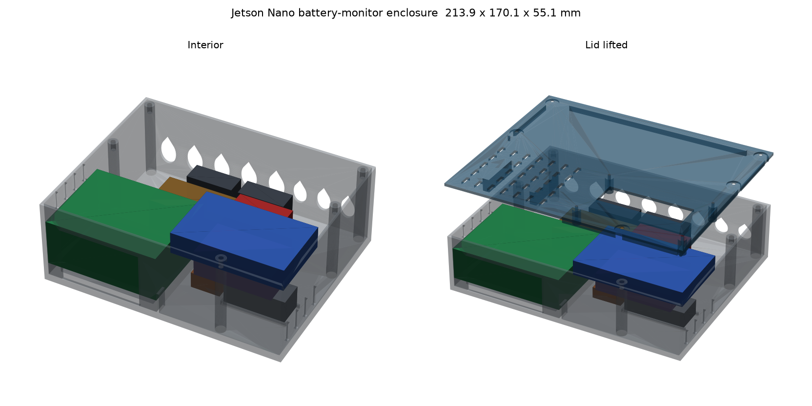

# Enclosure

Printable base and lid for the Jetson Nano battery monitor. The Korean summary is in [`../README.ko.md`](../README.ko.md), section 11. This file is the source of the dimensions and the citations.



Regenerate everything in this folder with:

```bash
python3 -m pip install -r requirements.txt
python3 enclosure.py
```

Tested with CadQuery 2.8.0, trimesh 5.2.2, and Python 3.12. The script writes `export/`, `preview.png`, and `export/manifold.txt`. It exits non-zero if the base and the lid are not single valid solids, if they intersect, or if either STL is not watertight.

Only `export/base` and `export/lid` are for printing. `export/assembly.step` is the base, the lid, and reference envelopes. Envelope names start with `REF_`. Names that also contain `UNVERIFIED` are boxes for parts that have no datasheet size yet.

| File | What it is |
|---|---|
| `enclosure.py` | Parametric model |
| `export/base.step`, `export/base.stl` | Base, print it standing on the floor |
| `export/lid.step`, `export/lid.stl` | Lid, outer face already on Z=0 |
| `export/assembly.step` | Base, lid, and reference envelopes |
| `export/dimensions.json` | Numbers the model actually built |
| `preview.png` | The figure above |

Last run: base STL watertight, 231683 mm³. Lid STL watertight, 94250 mm³. Both windings consistent (trimesh).

## Shunt

The shunt stays outside. Dissipation is `I²R` and the pack current is unknown, so the resistor may shed watts. This box is plastic, and the same air has to pass the Jetson heatsink. The INA228 sense pins do not carry the load current. IN+, IN−, and VBUS come in through one PG7. The fuse holder is inside, on the battery positive, before the conductor that leaves for the shunt's battery terminal. If the lead from the cell to this box is long, the fuse that protects that lead still belongs at the cell.

Inside the box the path is: battery positive, fuse, terminal, cable out to the shunt, cable back from the shunt's bus side, terminal split to the load, the charger, and the buck input. The buck's 5 V output stays in the box and plugs into the developer kit's barrel jack.

## Size

From `export/dimensions.json` for the defaults in `enclosure.py`:

| | mm |
|---|---|
| Outside | 213.9 × 170.1 × 55.1 |
| Cavity | 208.9 × 165.1 × 49.6 |
| Wall, floor, lid | 2.5, 3.0, 2.5 |
| Board and skirt clearance, each side | 0.25 |
| Extra radius on gland holes | 0.20 |

A 220 × 180 mm bed fits the base. The 213.9 mm side leaves little room for a brim.

## What sits where

South-west is the developer kit. It rests on 8 mm edge shelves. Corner ribs locate the 100 × 80 mm outline with 0.25 mm clearance per side. The ribs do not clamp the PCB, because the carrier thickness is not a published number. Two ribs on the lid stop 1 mm above the 29 mm envelope so the kit cannot lift out. The south wall and the west wall are open along the kit, with a sill below the carrier and a rail above the envelope. Connector coordinates are not published. Turn the kit so the barrel jack, USB, Ethernet, and HDMI face those openings. The 40-pin header should face the 8 mm channel on the north side of the kit, toward the terminals. UART wiring uses that channel and the UART gland.

East of the kit, the lid carries the Winstar WH2004A. The window is 75.0 × 23.2 mm, which is the 77.0 × 25.2 mm view area brought in 1 mm per side. Four M2 standoffs use the drawing's hole pattern. Under the display, on the floor, are the INA228 and the USB-I2C adapter. The adapter is held by cleats around its unverified envelope, not by invented mounting holes.

The north bay holds the fuse, the buck, and two terminal blocks, each on a 2 mm pad with two M3 slots. The slot is there because the real hole pitch is unknown. North of those parts is 18 mm of straight cable, then the gland wall.

## Glands

North wall, west to east. The catalogue hole is LAPP sheet T21, column D3 (PG7 12.8 mm with a −0.2 mm tolerance, PG9 15.5 mm with a −0.2 mm tolerance). The model adds 0.20 mm per side so a printed hole is not undersize. SKINTOP ST wrench flats are 15 mm (PG7) and 19 mm (PG9); both are larger than the printed hole, so the locknut still has a face to sit on. Overall length is 32 mm (PG7) and 36 mm (PG9). Keep that much clear outside the wall.

The hole is a teardrop with the point up, so the overhang is 45 degrees and the base prints without support. The point is print relief above the thread. A dab of sealant closes it if the gland has to be drip-resistant. This box is not a sealed outdoor housing.

| Name | Thread | Printed Ø |
|---|---|---|
| Battery in | PG9 | 15.9 |
| Shunt, battery side | PG9 | 15.9 |
| Shunt, bus side | PG9 | 15.9 |
| Load | PG9 | 15.9 |
| Charger | PG9 | 15.9 |
| Kelvin pair and VBUS | PG7 | 13.2 |
| USB | PG7 | 13.2 |
| UART | PG7 | 13.2 |

M12 and M16 were not used. A metric hole diameter was not taken from a drawing for this model, and inventing one would be worse than using the PG holes above. To switch, change the gland diameters in `enclosure.py` to a diameter you have a source for.

## Fasteners

Five M3 screws hold the lid. The bosses are on solid wall, not in the port opening, so the open corner is located by the skirt. The insert hole defaults to 4.0 mm diameter and 6.0 mm deep. That pair is a common starting point for a short M3 brass insert and it is not from an insert datasheet. Set `INSERT_HOLE_D` and `INSERT_DEPTH` from the insert you buy.

LCD and INA228 screws are M2, with ISO 4032 nuts in pockets (M2 across flats 4.0 mm, thickness 1.6 mm, plus 0.25 mm per side). Clearance holes follow ISO 273 medium: M2 2.4 mm, M3 3.4 mm.

## Print

- Material: PETG or ABS. The box sits next to the Jetson heatsink and the buck.
- Base: floor on the bed.
- Lid: the STL already has the outer face on Z=0 and the skirt, the LCD standoffs, and the stop ribs pointing up. Do not flip it again.
- 0.2 mm layers, 0.4 mm nozzle, 5 perimeters, 20% infill.
- No supports are designed in. Vent slots are 3 mm wide. Gland holes are teardrops. Nut pockets on the lid open upward in the print orientation. Nut pockets on the base open downward, into the first layers.
- Hole surfaces will need a test fit. If a gland will not start, raise `PRINT_HOLE_ALLOW` by a small step and reprint the trial, rather than drilling past the locknut face.

## Citations

Verified and used as geometry:

- NVIDIA Jetson Nano Developer Kit data sheet, January 2020. Mechanical 100 mm × 80 mm × 29 mm. Kit contents: module with heatsink and reference carrier board. [Mouser reprint of the NVIDIA sheet](https://www.mouser.com/datasheet/2/813/jetson_nano_devkit_datasheet_updates_us_v3-2487380.pdf). The module alone is 69.6 mm × 45 mm (module data sheet DA-09366). The pocket uses the kit envelope, not the module.
- The same kit sheet does not give carrier mounting-hole coordinates. NVIDIA has pointed at the P3449 carrier design files and the P3450 developer-kit STEP for those, and both sit behind a developer login. `JETSON_HOLE_XY` is empty. Filling it adds screw bosses at those coordinates, origin at the south-west corner of the kit outline. The hole diameter `JETSON_HOLE_D` (2.7 mm) is also unverified and is unused while the list is empty.
- Winstar WH2004A contour drawing, module 98.0 × 60.0 × 13.6 mm MAX, view area 77.0 × 25.2 mm, four Ø2.5 holes, pitch 93.0 mm and 55.0 mm, inset 2.5 mm. Non-specified dimensions on that drawing are ±0.3 mm. [Winstar PDF](https://www.winstar.com.tw/uploads/files/6e5109c5ba979085d164c6b48a5bb66d.pdf).
- Adafruit INA228, product 5832. PCB outline 25.4 × 20.32 mm and 2.5 mm holes at (2.54, 17.78) and (22.86, 17.78) mm, read from Adafruit's Eagle board `Adafruit INA228 I2C Power Monitor.brd`. Assembled size 25.8 × 20.2 × 10.1 mm from the [product page](https://www.adafruit.com/product/5832). The keep-out uses 25.8 × 20.4 × 10.1 mm so the PCB width is covered.
- LAPP cable-gland catalogue sheet T21 for the PG7 and PG9 panel holes, and the SKINTOP ST drawing for wrench size and overall length.
- ISO 273 medium clearance holes. ISO 4032 hex nuts.

## Unverified parameters

Change these in `enclosure.py`. Do not treat the defaults as a measured part. The cavity grows when a bay no longer fits.

| Name | Default | Note |
|---|---|---|
| `LCD_STANDOFF` | 13.6 mm | The module maximum. Correct if the PCB is the back face of that stack. The drawing also shows 9.0 mm and 1.6 mm (LED backlight). Shorten the standoff if the bezel hits the lid before the PCB meets it. |
| `LCD_BACKPACK_DEPTH` | 16 mm | PCF8574 backpack behind the LCD PCB. Not on the Winstar drawing. |
| `BUCK_L`, `BUCK_W`, `BUCK_H` | 66 × 36 × 20 mm | No 5 V 4 A buck is selected. Input range depends on the pack. |
| `FUSE_L`, `FUSE_W`, `FUSE_H` | 48 × 22 × 28 mm | No fuse holder is selected. |
| `TB_L`, `TB_W`, `TB_H` | 42 × 18 × 22 mm | One block, used twice. No terminal block is selected. |
| `ADAPTER_L`, `ADAPTER_W`, `ADAPTER_H` | 54 × 22 × 14 mm | No USB-I2C adapter is selected. |
| `BEND_CLEAR` | 18 mm | Straight length inside the gland before a bend is allowed. Depends on the cable. |
| `INSERT_HOLE_D`, `INSERT_DEPTH` | 4.0 mm, 6.0 mm | Match the heat-set insert datasheet. |
| `JETSON_HOLE_XY` | empty | See the citation above. |
| `JETSON_HOLE_D` | 2.7 mm | Unused until the list above is filled. |
